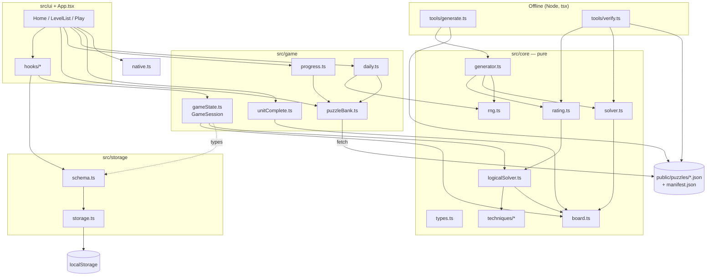
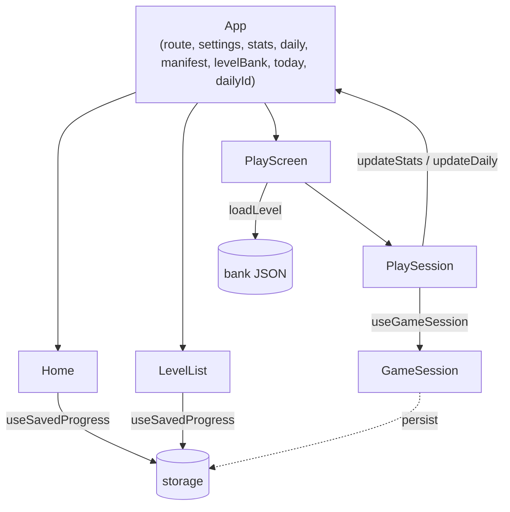

# Function Design — Sudoku Web Game

Tài liệu mô tả **chức năng, mô hình dữ liệu, luồng xử lý và quan hệ phụ thuộc** của game, theo đúng code
hiện tại (nhánh `ui-redesign`). Mục đích: làm căn cứ khi sửa/thêm tính năng — trước khi đổi một thứ gì, tra
mục [§11 Ma trận ảnh hưởng](#11-ma-trận-ảnh-hưởng) để biết nó kéo theo những gì.

Tài liệu đi kèm: [UI_DESIGN.md](UI_DESIGN.md) (giao diện), [ANDROID.md](ANDROID.md) (đóng gói),
[../CLAUDE.md](../CLAUDE.md) (nguyên tắc dự án). Nếu tài liệu này mâu thuẫn với code, **code đúng** — hãy sửa tài liệu.

---

## 1. Phạm vi sản phẩm

Sudoku chạy hoàn toàn client-side: không backend, không tài khoản. Hai nửa tách biệt:

| Nửa | Chạy khi nào | Việc | Nơi |
|---|---|---|---|
| **Offline** | Lúc dev, bằng Node | Sinh + kiểm tra ngân hàng màn chơi, commit thành JSON tĩnh | `src/core`, `tools/`, `public/puzzles/` |
| **Runtime** | Trong trình duyệt / WebView Android | Đọc JSON, chơi, lưu tiến độ vào `localStorage` | `src/game`, `src/storage`, `src/ui`, `src/App.tsx` |

Hai nửa chỉ gặp nhau ở **định dạng JSON** của bank (`PuzzleRecord`, `LevelBank`, `Manifest`) và ở các hàm thuần trong
`src/core` mà runtime dùng lại (gợi ý dùng `solveLogically`, bàn cờ dùng `board.ts`).

Android là bản đóng gói của đúng web app này bằng Capacitor (`src/native.ts` là chỗ duy nhất đụng native).

---

## 2. Nguyên tắc bất biến

Từ [CLAUDE.md](../CLAUDE.md), kèm hệ quả cụ thể trong code:

1. **Mỗi màn có đúng 1 lời giải** — `countSolutions(grid, 2) === 1` (generator kiểm khi sinh, `verify` kiểm lại).
2. **Mỗi màn giải được bằng suy luận thuần** — `rate(grid).solved` phải true với whitelist kỹ thuật của cấp đó.
3. **Sinh màn deterministic** — seed = `fnv1a("{level}#{index}#{GENERATOR_VERSION}[#{attempt}]")`. Tăng `count` không đổi màn cũ.
4. **Không sinh màn ở runtime.** Game chỉ `fetch` JSON.
5. **Không thư viện sudoku bên thứ ba** cho core.
6. **`src/core` là pure**: không DOM, không `Date.now()`, không `any`. Cả script Node lẫn trình duyệt dùng chung.

Bất biến phụ do tầng game/UI đặt ra:

7. **`solution` không bao giờ được ghi vào `localStorage`** (nó đã có trong bank).
8. **Không giới hạn cứng số lỗi** — tim chỉ là cách hiển thị `mistakes`, hết tim vẫn chơi tiếp.
9. **Không khoá màn nào** — người chơi mở màn bất kỳ.
10. **Mọi thao tác UI mutate bàn cờ phải đi qua `GameSession`** (không UI nào tự sửa `board`/`notes`).

---

## 3. Kiến trúc tổng thể



Quy tắc phụ thuộc (một chiều, không vòng):

- `core` **không** import từ `game`, `storage`, `ui`.
- `game` import `core` và chỉ **kiểu** từ `storage/schema` (không tầng game nào đọc/ghi storage).
- `storage` chỉ phụ thuộc `core/types` (cho `Level`).
- `ui` import mọi tầng dưới; **chỉ `ui/hooks` và `App`/screens gọi `storage/schema`**, `GameSession` không bao giờ tự lưu.
- `tools/` import `core` (và `fs`), không import `game/storage/ui`.

---

## 4. Core (`src/core`)

### 4.1 Biểu diễn dữ liệu (`types.ts`, `board.ts`)

| Khái niệm | Kiểu | Quy ước |
|---|---|---|
| Bàn cờ `Grid` | `Uint8Array(81)` | chỉ số `idx = row*9 + col`, ô trống = `0` |
| Chuỗi bàn cờ | `string` 81 ký tự | `.` hoặc `0`–`9`; `parseGrid` / `gridToString(g, '.'\|'0')` |
| Candidates | `Uint16Array(81)` | bitmask 9 bit, chữ số `d` ↔ `1 << (d-1)` |
| Ghi chú người chơi | `Uint16Array(81)` | cùng bitmask; mã hoá lưu: 3 ký tự hex/ô, nối liền (`encodeNotes`) |
| `Unit` | `readonly number[9]` | 27 unit: `ROWS`, `COLS`, `BOXES`, gộp `UNITS`; `UNITS_OF[idx]` = 3 unit chứa ô |
| `PEERS[idx]` | `Uint8Array` | 20 ô cùng hàng/cột/box |

`board.ts` cũng có `computeCandidates`, `isValidPlacement`, `isComplete`, `findConflicts`, `popcount`,
`candidateDigits`, `digitToBit`/`bitToDigit`.

### 4.2 Solver đếm nghiệm (`solver.ts`)

- `countSolutions(grid, limit = 2)` — backtracking có candidates, **dừng sớm khi đạt `limit`**. Dùng để kiểm duy nhất.
- `solveFirst(grid)` — tìm một nghiệm. Brute-force chỉ phục vụ kiểm tra/sinh, **không bao giờ** dùng để hướng dẫn người chơi.

### 4.3 Kỹ thuật & logical solver

`Technique { name, cost, find(grid, cands) → Step | null }`. `Step` = `{ technique, cost, placements[], eliminations[], cells[], explain }`.
`explain` là **dữ liệu**, không phải câu chữ: `Explanation { code, args }` (`args` gồm số, `UnitRef` hàng/cột/khối, `CellRef` hàng-cột, danh sách của chúng) để core không biết ngôn ngữ nào.
`game/explain.ts → explainText(explain, t)` dựng câu theo ngôn ngữ (khoá `explain.<code>` trong catalog). `cells` là các ô được highlight.

Thứ tự thử (`TECHNIQUE_ORDER` trong `techniques/index.ts`) — kỹ thuật rẻ nhất thử trước:

| Thứ tự | `name` | cost | Nhóm |
|---|---|---|---|
| 1 | `full-house` | 1 | Single |
| 2 | `naked-single` | 2 | Single |
| 3 | `hidden-single-box` | 3 | Single |
| 4 | `hidden-single-line` | 4 | Single |
| 5 | `pointing` | 6 | Locked candidates |
| 6 | `claiming` | 7 | Locked candidates |
| 7 | `naked-pair` | 8 | Subset |
| 8 | `hidden-pair` | 10 | Subset |
| 9 | `naked-triple` | 14 | Subset |
| 10 | `hidden-triple` | 16 | Subset |
| 11 | `x-wing` | 20 | Fish |
| 12 | `naked-quad` | 21 | Subset |
| 13 | `hidden-quad` | 22 | Subset |
| 14 | `skyscraper` | 26 | Single-digit chain |
| 15 | `swordfish` | 28 | Fish |
| 16 | `xy-wing` | 30 | Wing |
| 17 | `xyz-wing` | 32 | Wing |
| 18 | `w-wing` | 33 | Wing |
| 19 | `simple-coloring` | 34 | Colouring |
| 20 | `unique-rectangle-1` | 36 | Uniqueness |
| 21 | `jellyfish` | 40 | Fish |

`solveLogically(grid, { allowed? })` lặp tối đa 500 vòng: thử lần lượt từng kỹ thuật, kỹ thuật đầu tiên tìm được bước thì
áp dụng (đặt số → xoá candidate khỏi peers; hoặc xoá candidate theo `eliminations`) rồi quay lại đầu danh sách.
Trả `{ solved, grid, steps, stuckAt? }`. Hết kỹ thuật mà chưa xong ⇒ `solved: false` ⇒ màn bị loại.

Helper chung (`techniques/helpers.ts`): `nakedSubsetTechnique`, `hiddenSubsetTechnique`, `fishTechnique`.

### 4.4 Chấm độ khó (`rating.ts`)

`rate(grid)` chạy `solveLogically` rồi tính `maxCost` (cost lớn nhất trong các bước), `score` (tổng cost), `hardest`, `counts`
(số lần mỗi kỹ thuật), và `level` theo `TIERS`:

| Level | `maxCost` | Givens (ràng buộc phụ) | Kỹ thuật khó nhất rơi vào |
|---|---|---|---|
| beginner | 0–3 | 40–50 | full house, naked single, hidden single (box) |
| easy | 4–4 | 34–40 | + hidden single (hàng/cột) |
| medium | 5–10 | 30–36 | + pointing/claiming, naked/hidden pair |
| hard | 11–22 | 26–32 | + triple, x-wing, quad |
| expert | 23–40 | 22–28 | + skyscraper, swordfish, wings, coloring, UR, jellyfish |

> Độ khó được xác định bởi **kỹ thuật khó nhất bắt buộc**, không phải số ô cho sẵn. Đổi `cost` của một kỹ thuật hoặc
> `TIERS` sẽ làm **xếp lại cấp của mọi màn đã sinh** ⇒ `npm run verify` đỏ ⇒ phải tăng `GENERATOR_VERSION` và sinh lại.

### 4.5 Generator (`generator.ts`)

`generatePuzzle(level, index): PuzzleRecord | null`:

1. Với mỗi `attempt` (tối đa `MAX_ATTEMPTS[level]`: beginner 50, easy 200, medium 300, hard 2000, expert 400),
   seed = `fnv1a("{level}#{index}#{GENERATOR_VERSION}" + (attempt ? "#"+attempt : ""))`, `rand = mulberry32(seed)`.
2. `generateFullGrid(rand)` — backtracking có shuffle theo `rand`.
3. `chooseSymmetry(level)` — beginner/easy: xoay 180°; medium: xoay 180° hoặc đối xứng dọc; hard: xoay hoặc không; expert: không.
4. `digHoles` — duyệt ô theo thứ tự xáo; mỗi lần gỡ (cả cặp đối xứng) chỉ chấp nhận nếu vẫn **duy nhất nghiệm** và `maxCost`
   không vượt trần tier; sau mỗi lần gỡ thành công kiểm xem đã vào cửa sổ (givens + `maxCost`) chưa, nếu rồi thì dừng.
   Cho phép đào thấp hơn sàn givens tới `max(minGivens-10, 17)` để tìm cửa sổ hẹp (easy).
5. Kiểm lại cuối: duy nhất nghiệm, `solved`, `maxCost` và `givens` nằm trong tier ⇒ trả record; ngược lại thử `attempt` kế.

`GENERATOR_VERSION` (hiện = 1) nằm trong seed ⇒ **đổi version = đổi toàn bộ bank**.

### 4.6 RNG (`rng.ts`)

`fnv1a(string) → uint32`, `mulberry32(seed) → () => [0,1)`, `shuffleInPlace`. Cũng được `src/game/daily.ts` và
`ui/Confetti.tsx` dùng (confetti dùng seed cố định để vị trí ổn định giữa các lần render).

---

## 5. Pipeline offline & định dạng bank

### 5.1 Lệnh

```bash
npm run gen -- --level all --count 20          # sinh (giữ nguyên màn đã có nếu generatorVersion khớp)
npm run gen -- --level expert --count 100 --force   # sinh lại từ đầu (ĐỔI puzzle)
npm run verify                                  # kiểm toàn bộ bank (thoát mã 1 nếu có lỗi)
```

`generate.ts`: đọc bank hiện có; nếu `generatorVersion` khớp và không `--force` thì **tái sử dụng** `puzzles[index]` đã có,
chỉ sinh phần còn thiếu ⇒ tăng `count` không đổi màn cũ. Ghi file theo kiểu atomic (ghi `.tmp` rồi `rename`). Nếu một `index` sinh thất bại sau mọi lần thử, **không ghi đè** file bank cũ (thoát mã 1);
chỉ bank đủ `0..count-1` mới được ghi. `manifest.json` luôn được cập nhật.

### 5.2 Định dạng

```ts
PuzzleRecord { id: "easy-007", index: 6, puzzle: "81 ký tự .", solution: "81 chữ số",
               givens, symmetry, seed, rating: { maxCost, score, hardest, counts } }
LevelBank    { schemaVersion, generatorVersion, level, count, puzzles: PuzzleRecord[] }
Manifest     { schemaVersion, generatorVersion, levels: [{ level, count, file }] }
```

- **ID** = `{level}-{index+1 pad 3}`. Hàm một chiều duy nhất ở runtime: `puzzleIdOf(level, index)` /
  `levelFromPuzzleId(id)` (`game/puzzleBank.ts`). Mọi nơi dựng/phân tích id phải dùng hai hàm này.
- Một file/cấp (`beginner.json` … `expert.json`) + `manifest.json`. Hiện 100 màn/cấp.

### 5.3 `verify` kiểm gì (cho mỗi màn)

`bank.level` đúng; `index` liên tục từ 0; `id` không trùng; độ dài 81; solution đầy đủ; givens khớp solution;
chuỗi round-trip; `givens` ghi đúng số thực; **duy nhất nghiệm**; **giải được bằng logic**; **`rate().level` đúng cấp**.

---

## 6. Mô hình dữ liệu runtime

### 6.1 Khoá `localStorage` (namespace `sudoku:v1:`)

| Khoá | Kiểu | Ghi bởi | Đọc bởi |
|---|---|---|---|
| `meta` | `{ schemaVersion, generatorVersion, createdAt, updatedAt }` | `migrate`, `syncGeneratorVersion` | cùng |
| `settings` | `Settings` | `useSettings` | `useSettings` (App) |
| `stats` | `Record<Level, LevelStats>` | `useStats` (từ `PlaySession`) | `useStats`, Home |
| `game:<puzzleId>` | `SavedGame` | `useGameSession` | `useGameSession`, `listGames` |
| `last` | `{ puzzleId, at }` | `useGameSession` | `useSavedProgress` (Home) |
| `daily` | `DailyState` | `useDaily` | `useDaily`, Home, Play, Calendar |
| `achievements` | `Record<id, unlockedAtMs>` | `useAchievements.check` | `useAchievements` (Home, Thành tựu) |
| `weekly` | `{ done: string[] }` (thứ Hai của các tuần đã hoàn thành chuỗi tuần) | `PlaySession` (khi xong màn thứ 5) | `loadWeekly` (Home, Modes, XP, thành tựu) |

```ts
SavedGame { puzzleId, board: 81 ký tự ('.' trống), notes: 243 ký tự hex, elapsedMs, mistakes, hintsUsed,
            status: 'in-progress'|'completed', completedAt?, mode?: 'time'|'perfect', updatedAt }
Settings  { highlightSameDigit, highlightPeers, showMistakes, autoRemoveNotes, theme: 'system'|'light'|'dark', soundEnabled, hapticsEnabled,
            boardPalette: 'violet'|'ocean'|'forest'|'sunset', seenIntro, reminderEnabled, language: 'auto'|'vi'|'en' }
LevelStats{ played, completed, bestMs|null, totalMs, perfectRuns }
DailyState{ streak, longest, lastDate: 'YYYY-MM-DD' | null, freezes }   // ngày theo giờ máy; freezes = số đóng băng chuỗi đang giữ (0–2)
```

Không lưu: `solution`, undo stack, hint đang xem trước, lựa chọn ô, chế độ ghi chú, trạng thái tạm dừng.

### 6.2 Dữ liệu **dẫn xuất** (không có khoá riêng)

| Đại lượng | Công thức | Hàm |
|---|---|---|
| Sao một màn | `max(1, 3 - mistakes)` | `progress.starsFor` |
| Tim còn lại | `max(0, 3 - mistakes)` | `progress.heartsLeft` |
| Số màn xong / tổng sao mỗi cấp | quét `listGames()` rồi gộp theo cấp | `progress.summarizeByLevel` |
| Màn đề xuất kế tiếp của một cấp | in-progress mới nhất → màn đầu chưa xong → màn đầu | `progress.pickNextIndex` |
| Chuỗi hiển thị | `streak` nếu `lastDate` là hôm nay/hôm qua, ngược lại 0 | `daily.currentStreak` |
| Kỷ lục toàn cục | `min(stats[level].bestMs)` | tính trong `HomeScreen` |
| XP, cấp người chơi | tổng `xpForSolve(cấp, lỗi, mode)` trên mọi ván `completed` (+50% nếu có `mode`) + `300 × số tuần đã xong`; cấp `L` cần `50·L·(L−1)` XP | `xp.totalXp(games, weeksDone)`, `xp.playerLevel` |
| Một lượt chế độ đã thua chưa | `time`: chưa xong và `elapsedMs ≥ giới hạn cấp`; `perfect`: `mistakes > 0` | `GameSession.failure()` ← `modes.modeFailure` |
| Tiến độ chuỗi tuần | màn của tuần `completed` **và** `completedAt` nằm trong tuần | `weekly.weeklyProgress` |
| Thành tựu đạt được | mỗi thành tựu = một số đo (`progress(ctx)`) ≥ `target` | `achievements.evaluateAchievements` |
| Kỹ thuật "đã thành thạo" | có ván `completed` với `hintsUsed = 0` thuộc màn mà `rating.counts[kỹ thuật] > 0` | `practice.masteredTechniques` |
| Ngày đã làm trên lịch | ván của `dailyPuzzle(ngày)` có `status = completed` | `CalendarScreen` |

> Vì sao sao/tim không lưu riêng: `SavedGame.mistakes` đã đủ, lưu thêm là dữ liệu trùng có thể lệch nhau.
> Hệ quả: đổi công thức `starsFor` sẽ **áp dụng ngược** cho mọi màn đã xong.

---

## 7. Tầng storage (`src/storage`)

### 7.1 Adapter (`storage.ts`)

`readJSON(key, fallback, validate?)`, `writeJSON(key, value) → boolean`, `removeKey`, `removeAllWithPrefix`, `listKeysWithPrefix`, `isAvailable`,
`getStorageHealth` / `subscribeStorageHealth`.

- Mọi truy cập bọc `try/catch`. `localStorage` không dùng được ⇒ tự chuyển sang `Map` trong bộ nhớ (game vẫn chơi, mất khi tải lại).
- `readJSON` gặp JSON hỏng **hoặc `validate` trả `null`** (sai hình dạng) ⇒ xoá khoá, trả `fallback`. Dữ liệu đọc từ storage là **không đáng tin**
  (người chơi sửa tay, app khác cùng origin ghi đè, bản build cũ); mọi `load*` trong `schema.ts` đều truyền validator.
- `QuotaExceededError` ⇒ xoá ván `completed` cũ nhất (theo `completedAt`) rồi thử lại một lần; vẫn thất bại ⇒ `writeJSON` trả `false`.
- `getStorageHealth()` = `'ok' | 'memory-only' | 'write-failed'` (dùng với `useSyncExternalStore`); `StorageBanner` đọc nó để báo người chơi khi tiến độ
  không được lưu.

### 7.2 Schema (`schema.ts`)

Chứa kiểu, `KEYS`, `DEFAULT_*`, các hàm `load*/save*`, `listGames()`, `clearAllProgress()` (xoá mọi khoá tiền tố `sudoku:`).

- Mỗi loại bản ghi có một validator: `parseSavedGame`, `parseStats`, `parseSettings`, `parseDaily`, `parseLast`, `parseMeta`. Chúng kiểm kiểu, độ dài
  (`board` 81 ký tự, `notes` 243 hex), khoảng giá trị (số hữu hạn, không âm, có trần), `puzzleId` đúng dạng (`core/levels.isPuzzleId`) và — với
  `SavedGame` — khớp với khoá nó nằm dưới. Bản ghi hỏng bị xoá và thay bằng mặc định; **không validator nào được ném lỗi**.
- `parseSettings` / `parseDaily` **gộp từng trường lên mặc định** ⇒ thêm trường mới vào `Settings`/`DailyState` an toàn với dữ liệu cũ, một trường sai
  không làm mất cả bản ghi. `parseStats` đặt lại riêng cấp nào hỏng/thiếu (cấp mới thêm sau cũng tự có mặc định).
- Thêm trường vào kiểu nào thì **phải** sửa validator tương ứng (nếu quên, trường mới bị bỏ khi đọc lại).
- `migrate()` chạy một lần khi khởi động (tạo `meta` nếu chưa có; nơi đặt các bước `vN → vN+1` sau này).
- `syncGeneratorVersion(manifestVersion)` ghi version bank hiện tại vào `meta`, trả `true` nếu khác bản trước. `App` hiện **bỏ qua**
  giá trị trả về; cơ chế bảo vệ thực sự là `GameSession.matchesGivens` (xem §8.1).

### 7.3 Nhịp ghi (trong `useGameSession`)

- Debounce **500 ms** sau mỗi thay đổi bàn cờ/ghi chú/gợi ý.
- Ghi **ngay** khi: hoàn thành màn, `reset`, `visibilitychange → hidden`, `pagehide`, rời màn (cleanup khi unmount).
- Đồng hồ: chỉ lưu `elapsedMs` tích luỹ; chỉ tick khi tab đang `visible`.
- Mỗi lần ghi `SavedGame` cũng ghi `last`.

---

## 8. Tầng game (`src/game`)

### 8.1 `GameSession` (`gameState.ts`) — máy trạng thái một ván

Trạng thái: `givens`, `solution`, `board`, `notes`, `elapsedMs`, `mistakes`, `hintsUsed`, `status`, `autoRemoveNotes`, `undoStack`, `pendingHintStep`.
`board`/`notes` **bị sửa tại chỗ** (mutate) — vì vậy UI dùng `version` để biết khi nào đổi (xem §9.3).

| Thao tác | Điều kiện bỏ qua | Hiệu ứng |
|---|---|---|
| `setDigit(idx, d)` | `d∉1..9`, đã `completed`, ô là given | đặt số; nếu `autoRemoveNotes` gỡ `d` khỏi ghi chú mọi peer (ghi vào `autoNoteChanges` cùng một `Move`); `d !== solution[idx]` ⇒ `mistakes++`; đẩy `Move`; nếu bàn đầy & khớp `solution` ⇒ `status = 'completed'` |
| `eraseCell(idx)` | completed, given, ô trống | đặt `0`, đẩy `Move` (ghi chú của ô giữ nguyên) |
| `toggleNote(idx, d)` | completed, given, ô đã có số | lật bit `d` trong `notes[idx]`, đẩy `Move` |
| `undo()` | stack rỗng | khôi phục `value`+`notes` của ô và toàn bộ `autoNoteChanges`; nếu đang `completed` ⇒ về `in-progress`. **Không** hoàn `mistakes`/`hintsUsed`. Stack giữ tối đa 500 nước gần nhất |
| `hint()` | completed | **Lần 1**: `solveLogically(board bỏ các số sai của người chơi).steps[0]` lưu vào `pendingHintStep` và trả về (chỉ xem trước). **Lần 2** (còn pending): `hintsUsed++`, áp dụng bước (placements qua `setDigit`, eliminations qua `toggleNote` nếu bit đang bật). Mọi thay đổi bàn cờ/ghi chú (`setDigit`/`eraseCell`/`toggleNote`/`undo`) **huỷ** `pendingHintStep`; UI hỏi `hasPendingHint()` |
| `reset()` | — | về ván mới: `board = givens`, xoá notes/đếm/undo/hint, `in-progress` |
| `tick(ms)` | completed | cộng `elapsedMs` |
| `toSaved(now)` / `fromSaved(opts, saved)` | — | (de)serialize; `completedAt` chỉ khi completed. `fromSaved` chỉ tin `status: 'completed'` nếu bàn cờ thật sự khớp `solution`, ngược lại coi là `in-progress`. Ghi chú được che về 9 bit |
| `GameSession.matchesGivens(puzzle, saved)` | — | true nếu mọi given của puzzle hiện tại trùng `saved.board` ⇒ nếu sai thì **bỏ save cũ, bắt đầu lại** (bank đã đổi) |

`redo()` áp lại nước vừa `undo` (kể cả `autoNoteChanges`), không đụng `mistakes`/`hintsUsed`; mọi nước mới xoá redo stack. `fillNotes()` ghi candidates (từ `computeCandidates(board)`) vào mọi ô trống thay cho ghi chú cũ, thành **một** nước (`type: 'fill-notes'`, `idx: -1`, chỉ có `autoNoteChanges`); trả `false` và không ghi gì nếu không có gì đổi. `useGameSession.createSession` dựng session **trong lúc render** nên không bao giờ được ném: save không khôi phục được ⇒ xoá save, bắt đầu ván mới.

### 8.2 `progress.ts`

`MAX_HEARTS = 3`, `heartsLeft`, `starsFor`, `summarizeByLevel(games)`, `pickNextIndex(level, count, gamesById)`. Chỉ phụ thuộc kiểu + `puzzleBank` (id helper).

### 8.3 `daily.ts` — thử thách hôm nay

- `dateKey(date)` → `YYYY-MM-DD` giờ máy. Ngày được **truyền vào** (hàm thuần, test được).
- `dailyPuzzle(key, countOf)` → `{ level, index, id }`. Cấp lấy theo lịch quay 7 ngày
  `['easy','medium','easy','hard','medium','hard','expert'][dayNumber % 7]`; `index = fnv1a("daily:"+key) % count`.
  Cùng ngày ⇒ cùng màn trên mọi thiết bị.
- `completeDaily(daily, today)` → `{ next, milestone, freezeUsed, freezeEarned }`: đã làm hôm nay ⇒ giữ nguyên (`next === daily`); `lastDate` là hôm qua ⇒ `streak+1`;
  `lastDate` là **hôm kia** và còn `freezes > 0` ⇒ tiêu một đóng băng, `streak+1`; ngược lại `streak=1`. Luôn cập nhật `longest`. Cứ mỗi bội số 7 của `streak`
  nhận thêm 1 đóng băng (tối đa `MAX_FREEZES = 2`). `milestone` là độ dài chuỗi nếu thuộc `STREAK_MILESTONES` (3, 7, 14, 30, 60, 100, 365). `recordDailyCompletion` = `completeDaily(...).next`.
- `currentStreak`: chuỗi còn sống nếu `lastDate` là hôm nay/hôm qua, hoặc là hôm kia mà còn đóng băng. `isDailyDone`, `previousDateKey`.
- Chỉ thử thách **hôm nay** (`dailyId`) mới tính vào chuỗi; làm bù ngày cũ từ Lịch chỉ đánh dấu trên lịch (ván đã xong), không đổi `daily`.

### 8.3b `achievements.ts`, `xp.ts`, `palettes.ts`, `calendar.ts`

- **`achievements.ts`**: `ACHIEVEMENTS` (24 mục) — mỗi mục là `{ id, icon, target, progress(ctx) }` (tên/mô tả ở catalog: `ach.<id>.title|desc`, lấy bằng `achievementText(id, t)`) với `ctx = { games, stats, daily, weeklyDone }`. Không có khoá lưu riêng cho *tiến độ*;
  chỉ lưu *thời điểm mở khoá* (`achievements`) để (a) báo "Thành tựu mới" đúng một lần, (b) giữ thành tựu đã đạt kể cả khi dữ liệu nền co lại (chơi lại một màn xoá save của nó).
  `unlockNew(stored, ctx, now)` trả `{ unlocked, added }` (cùng tham chiếu `stored` nếu không có gì mới). `useAchievements.check()` đọc games/stats/daily **thẳng từ storage** (nên thấy kết quả ván vừa lưu) rồi ghi bản mới.
  Thêm thành tựu = thêm một phần tử vào `ACHIEVEMENTS` (id mới, chữ thường/số/gạch ngang); thành tựu mới tự được mở khoá hồi tố ở lần `check()` kế.
- **`xp.ts`**: `xpForSolve(cấp, lỗi)` = `{10, 20, 40, 80, 150}[cấp] × {1, 0.8, 0.6}[sao]`. `playerLevel(xp)` → `{ level, titleKey, into, span }` (`titleKey` là khoá catalog). Vì XP dẫn xuất từ các ván đã xong, chơi lại một màn không làm XP phình ra.
- **`palettes.ts`**: 4 bảng màu bàn cờ (`labelKey` là khoá catalog), mở khoá theo cấp người chơi (1, 3, 6, 10). `Settings.boardPalette` → `data-palette` trên `<html>` (App), CSS ở `index.css`.
- **`calendar.ts`**: `monthWeeks(ym)` (tuần bắt đầu thứ Hai, ô ngoài tháng là `null`), `addMonths`, `compareMonths`. Lịch cho duyệt lùi `CALENDAR_MONTHS_BACK = 12` tháng.

### 8.3d Chế độ thử thách: `modes.ts`, `weekly.ts`, `reminders.ts`

- **Chế độ là luật của *một lượt chơi*, không đổi luật Sudoku** (không có biến thể luật). `SavedGame.mode` (tuỳ chọn) lưu cùng ván; `GameSession.mode` đọc từ save, nên **ván đã lưu giữ chế độ của nó** bất kể link xin chế độ nào. Chế độ chỉ áp lên màn *chưa có save* (`#/play/<id>/<time|perfect>`).
  - `time` (Đua thời gian): đếm ngược theo cấp, `TIME_LIMIT_MS` = 3 / 5 / 8 / 12 / 20 phút (beginner…expert). `tick` bị kẹp ở giới hạn; hết giờ ⇒ `failure() = 'time-up'`.
  - `perfect` (Không sai): `mistakes > 0` ⇒ `failure() = 'mistake'`. Số sai vẫn được đặt vào ô (tim trừ như thường) rồi bàn bị khoá.
  - Khi `failure() !== null` mọi thao tác ghi (`setDigit`, `eraseCell`, `toggleNote`, `fillNotes`, `undo`, `redo`, `hint`) bị bỏ qua và đồng hồ dừng. Thất bại **dẫn xuất từ số liệu** của ván nên không lưu cờ riêng: mở lại ván dở sẽ thấy lại màn thất bại.
  - Lối thoát: `reset()` (giữ chế độ, "Thử lại"), `clearMode()` ("Chơi tiếp như bình thường": bỏ chế độ, giữ bàn và số lỗi), hoặc quay lại màn chế độ.
  - Thắng một lượt chế độ ⇒ XP ×`MODE_XP_MULTIPLIER = 1.5` (dẫn xuất từ `game.mode`, nên bỏ chế độ giữa chừng thì mất thưởng) và tính cho thành tựu `time-1`, `perfect-1`, `perfect-10`.
  - `pickFreshIndex(level, count, games)` (progress.ts): màn đầu tiên **chưa có save** của cấp (null nếu hết) — màn chế độ mở từ màn Chế độ luôn là màn mới.
- **`GameSession.completedAt`**: nay được giữ cố định — lần lưu đầu tiên sau khi xong đóng dấu, các lần lưu sau (mở lại, rời màn) không đổi; hoàn tác nước cuối thì xoá. (Trước đây `toSaved(now)` đặt lại mỗi lần lưu, làm thời điểm hoàn thành trôi.) Chuỗi tuần dựa vào nó.
- **`weekly.ts`**: chuỗi thử thách tuần = 5 màn `['easy','medium','medium','hard','expert']`, tuần tính **từ thứ Hai** theo giờ máy (`weekStartKey`, `weekEndKey`). `weeklyPuzzles(tuần, countOf)` xác định theo `fnv1a("weekly:<thứ Hai>:<i>")`, không trùng màn. Một bước **chỉ tính** khi ván `completed` có `completedAt` trong tuần (`weekRangeMs`, nửa mở), nên màn đã xong từ trước không làm sẵn chuỗi. Bước không bắt buộc theo thứ tự.
  Khi bước thứ 5 xong, `PlaySession` ghi tuần vào `weekly.done` **một lần** và thưởng `WEEKLY_BONUS_XP = 300` (cộng vào `totalXp` qua `weeksDone`); thành tựu `weekly-1`, `weekly-4`.
- **`reminders.ts`**: `planReminders({ now, dailyDone, streak }, t)` (chữ thông báo được dịch **lúc đặt lịch**, nên `useReminders` đặt lại lịch khi đổi ngôn ngữ) → tối đa 7 nhắc nhở lúc `REMINDER_HOUR = 20` giờ máy, id `7100 + số ngày`. Bỏ nhắc hôm nay nếu đã làm thử thách hoặc đã quá 20:00. Chỉ nhắc **đầu tiên** nhắc tới chuỗi (các nhắc sau sẽ rơi vào ngày đã lỡ).

### 8.3c Học kỹ thuật: `techniqueInfo.ts`, `practice.ts`, `techniqueExample.ts`

- **`techniqueInfo.ts`**: `TECHNIQUES` — id + nhóm của đủ 21 kỹ thuật, **cùng thứ tự `TECHNIQUE_ORDER`** (có test khoá điều này). Nhãn, tóm tắt, các bước (một chuỗi, mỗi bước một dòng) và mẹo nằm trong catalog (`tech.<id>.label|summary|steps|tip`, `tech.group.<nhóm>`); `techniqueInfo(id, t)` ghép lại. Thêm kỹ thuật vào core ⇒ phải thêm bài học ở **cả hai** catalog.
- **`practice.ts`**: `practicePuzzles(kỹ thuật, banks)` xếp các màn cần kỹ thuật đó (màn mà nó là bước khó nhất trước, rồi theo `rating.score` tăng dần). Đọc `rating` **phòng thủ** vì `validateLevelBank` chỉ kiểm lưới. `masteredTechniques` xem bảng §6.2.
- **`techniqueExample.ts`**: `findTechniqueExample(puzzle, kỹ thuật)` chạy lại logical solver (cùng `TECHNIQUE_ORDER`, dùng `applyStep` export từ `logicalSolver`) và dừng ở lần đầu kỹ thuật đó tiến hành ⇒ bàn thật + candidates + `Step` để vẽ `ExampleBoard`. Chạy theo yêu cầu (khi mở bài học), không trong render danh sách.
- Hiện bank không có màn nào cần `naked-quad`, `hidden-quad`, `jellyfish` ⇒ bài học vẫn hiện, ví dụ/luyện tập báo "chưa có". `swordfish` chỉ có 1 màn.

### 8.4 `unitComplete.ts`

`completedUnitCells(board, solution, idx) → Map<cell, khoảng cách>`: nếu ô `idx` đúng, với mỗi unit đi qua `idx` mà **cả 9 ô đều khớp
solution** thì thêm 9 ô vào map kèm khoảng cách (theo vị trí trong unit) tới `idx` (lấy min nếu thuộc nhiều unit). UI dùng để gợn sóng.

### 8.5 `puzzleBank.ts`

`loadManifest`, `loadLevel(level)` (cache theo module + chia sẻ promise đang chạy), `getPuzzle(id)`, `levelFromPuzzleId`, `puzzleIdOf`,
`validateManifest`, `validateLevelBank`, `resetPuzzleBankCache` (cho test). URL = `import.meta.env.BASE_URL + 'puzzles/'` (đúng cả khi deploy dưới subpath).

- JSON tải về được **validate** trước khi vào cache (dạng manifest, `file` chỉ là tên `*.json` đơn giản, id/index/puzzle/solution của từng màn, given khớp
  solution). Sai ⇒ ném lỗi, màn hiển thị lỗi + nút "Thử lại".
- Chỉ **thành công** mới được nhớ: promise bị reject bị gỡ khỏi cache nên "Thử lại" tải lại thật. `fetch` có timeout 15 s.

---

## 9. Tầng ứng dụng (`App.tsx`, `src/ui`)

### 9.1 Routing (hash)

| Hash | Màn | Ghi chú |
|---|---|---|
| `#/` (hoặc không khớp) | Home | |
| `#/level/<level>` | LevelList | `level` phải thuộc 5 cấp, nếu không → Home |
| `#/play/<puzzleId>` | Play | `puzzleId` phải đúng dạng `<level>-<số>` (`isPuzzleId`), nếu không → Home. Đúng dạng nhưng không có trong bank ⇒ màn lỗi + nút quay lại |
| `#/play/<puzzleId>/<time\|perfect>` | Play với chế độ thử thách | chế độ lạ bị bỏ qua (vẫn chơi bình thường) |
| `#/modes` | Chế độ thử thách (chuỗi tuần + Đua thời gian + Không sai) | |
| `#/achievements` | Thành tựu | |
| `#/calendar` | Lịch thử thách | |
| `#/stats` | Thống kê | |
| `#/learn` | Danh sách kỹ thuật | |
| `#/learn/<kỹ thuật>` | Bài học một kỹ thuật | `id` phải thuộc `TECHNIQUE_INFO` (`isTechniqueId`), nếu không → Home |

Hash là thứ duy nhất kẻ khác có thể điều khiển từ xa (gửi link), nên `parseHash` chỉ cho qua giá trị đã kiểm tra.

`navigate(hash, replace?)`. Quy ước điều hướng:

| Hành động | Kiểu | Đích |
|---|---|---|
| Vào level / vào màn chơi / "Chơi tiếp" / "Thử thách" | push | |
| Back ở Play | replace | `#/level/<cấp của màn>` |
| Back ở LevelList | replace | `#/` |
| Back ở Thành tựu / Lịch / Thống kê / Học / Chế độ | replace | `#/` |
| Back ở Play khi ván có chế độ | replace | `#/modes` |
| "Màn tiếp theo" khi ván có chế độ | replace | màn mới kế tiếp cùng chế độ (hoặc `#/modes` nếu hết) |
| "Màn tuần tiếp theo" (xong một bước của tuần) | replace | bước tuần chưa xong đầu tiên |
| Back ở bài học một kỹ thuật | replace | `#/learn` |
| "Màn tiếp theo", "Danh sách màn" ở màn Hoàn thành | replace | màn kế / level list |
| Nút Back Android (`native.ts`) | — | `#/` nếu đang ở màn con, thoát app nếu đang ở Home |

Dùng `replace` cho các bước "đi lên"/"tiếp" để nút Back của trình duyệt không quay lại màn đã xong.

### 9.2 Sở hữu state



| State | Chủ | Vòng đời | Ghi chú |
|---|---|---|---|
| `route` | `useHashRoute` (App) | toàn app | |
| `settings` | `useSettings` (App) | toàn app, lưu | truyền xuống Home (để sửa) và Play (để đọc) |
| `stats`, `daily` | `useStats`, `useDaily` (App) | toàn app, lưu | Play gọi `updateStats`/`updateDaily` khi hoàn thành |
| `manifest`, `levelBank` | App | tải lúc cần | `levelBank` chỉ cho route `level` |
| `today`, `dailyId` | App, tính **mỗi lần render** | — | mở app qua nửa đêm sẽ cập nhật ở lần render kế |
| `GameSession` | `useGameSession` (ref) | theo `puzzleId` | không phải React state — mutate tại chỗ |
| `version` | `useGameSession` | tăng mỗi mutation | **khoá thay đổi** cho mọi `useMemo`/memo phụ thuộc bàn cờ |
| `selected`, `noteMode`, `paused`, `hintPreview`, `wave`, `showCompletion`, `recordAtCompletion` | `PlaySession` | theo màn chơi | không lưu |
| `settingsOpen` | `HomeScreen` | | |
| `page` (tab nhóm màn) | `LevelListScreen` (`pageOverride`) | | mặc định = trang chứa màn đề xuất |

### 9.3 Quy tắc "mutate tại chỗ + `version`"

`session.board`/`session.notes` giữ nguyên tham chiếu; `useGameSession` gọi `rerender()` (tăng `version`) sau mỗi thao tác.
Mọi `useMemo`/`memo` phụ thuộc bàn cờ **phải** lấy `version` làm khoá (đã áp dụng ở `Board.highlights` và `PlaySession.remaining`). `Cell` được
`memo` theo các prop nguyên thuỷ (`value, notes, isGiven, isWrong, highlight, waveDelay`) và `onSelect` **phải ổn định**
(`useCallback`) — nếu không, cả 81 ô render lại mỗi lần.

### 9.3b Chịu lỗi và dữ liệu không tin cậy

- `ErrorBoundary` (bọc `App` trong `main.tsx`): lỗi ném khi render ⇒ màn "Có lỗi xảy ra" với **Tải lại** và **Xóa dữ liệu và tải lại**. Không có nó, một lỗi render
  làm cả cây React biến mất và không còn điều khiển nào để thoát.
- `StorageBanner` (đầu `App`): hiện khi `getStorageHealth() !== 'ok'`.
- `useStats` / `useDaily` / `useSettings` dùng `usePersistedState`: mỗi lần cập nhật **bắt đầu từ bản đang lưu** (không phải snapshot của tab) để hai tab không
  ghi đè tiến độ của nhau; updater chạy ngoài `setState` nên StrictMode không áp dụng một lần tăng hai lần. Nếu lần ghi trước thất bại thì dùng bản trong bộ nhớ.
- Lỗi tải manifest/level ⇒ Home / LevelList / Play hiện nút **Thử lại** (`App.attempt`); phản hồi cũ của level trước không ghi đè level hiện tại.
- Bàn phím: phím giữ (`e.repeat`) chỉ được lặp với mũi tên, Backspace/Delete và `U`; chữ số, `N`, `H`, Space không lặp.

### 9.4 `useSavedProgress`

Home/LevelList đọc `listGames()` + `loadLast()`. Màn Play lưu lần cuối trong **cleanup khi unmount**, tức *sau* lần render đầu của màn kế
tiếp, nên hook đọc lại trong `useEffect` lúc mount để lấy dữ liệu mới nhất.

### 9.5 Luồng chính

**Mở một màn**
1. `PlayScreen` `loadLevel(level)` → tìm `puzzle` theo id → `PlaySession` (key = id).
2. `useGameSession` tạo `GameSession`: có `SavedGame` và `matchesGivens` ⇒ `fromSaved`; ngược lại ván mới.
3. Nếu `status === 'completed'` ⇒ hiện thẳng màn Hoàn thành, **không** cộng stats.

**Điền số** (`PlaySession.handleDigit`)
1. Bỏ qua nếu chưa chọn ô / đang tạm dừng / đang hiện màn Hoàn thành.
2. Chế độ ghi chú ⇒ `toggleNote`; ô đã có đúng số đó ⇒ `eraseCell`; còn lại ⇒ `setDigit` rồi `completedUnitCells` → `wave`.
3. `useGameSession` bump `version`, lên lịch lưu (debounce).

**Gợi ý**: `H`/nút → `hint()` lần 1 hiện `hintPreview` (highlight `cells`, hiện `explain`, nút đổi thành "Áp dụng"); lần 2 áp dụng, `hintsUsed++`,
xoá preview, gợn sóng ở các ô vừa đặt.

**Hoàn thành**
1. `session.status` chuyển `completed` ⇒ `useGameSession` ghi ngay.
2. `PlaySession` (một lần, nhờ `statsUpdatedRef`): so `elapsedMs` với `stats[level].bestMs` ⇒ `isNewRecord`; `updateStats` (played+1, completed+1, bestMs, totalMs, perfectRuns);
   nếu `puzzle.id === dailyId` ⇒ `updateDaily(completeDaily)` (và giữ `DailyCompletion` để biết mốc/đóng băng).
   Cũng ở bước này (vẫn đúng một lần): tính **phần thưởng** `CompletionReward` — XP của ván (`xpForSolve`), có lên cấp không (so `playerLevel` trước/sau, trước = sau − XP),
   bảng màu vừa mở khoá, `useAchievements.check()` (thành tựu mới), mốc chuỗi, đóng băng dùng/nhận, **chế độ** (+50% XP) và **chuỗi tuần** (đếm tiến độ, thưởng một lần khi đủ 5). Mở lại màn đã xong **không** có phần thưởng.
3. Sau `COMPLETION_DELAY_MS = 750` hiện `CompletionScreen` (để thấy số cuối + sóng) và phát tiếng `win`.
4. "Chơi lại" ⇒ `reset()` + hạ `statsUpdatedRef` ⇒ lần hoàn thành sau sẽ tính lại stats.

**Rời màn / ẩn tab**: lưu ngay.

### 9.6 Home — quy tắc hiển thị

- **Thẻ chính** (cần `manifest`): nếu `last` trỏ tới ván `in-progress` ⇒ "Chơi tiếp" (kèm thời gian, tim); ngược lại ⇒ "Màn tiếp theo"
  (cấp của `last`, qua `pickNextIndex`) hoặc "Bắt đầu chơi" (beginner khi chưa có `last`).
- **Thử thách hôm nay** (cần `manifest` và `dailyId`): chưa xong ⇒ nút "Chơi"; xong ⇒ dấu tick.
- **Thống kê**: Đã giải/Sao từ `summarizeByLevel(listGames())` (nguồn thật là các `SavedGame`, **không** phải `stats.completed`); Kỷ lục = min `bestMs`.
- **Thẻ cấp**: `completed/count` + thanh tiến độ (tối thiểu 0.75rem khi >0).
- **Thẻ người chơi** (`PlayerCard`): cấp, danh hiệu, thanh XP; bấm vào mở Thành tựu. **Lối tắt** 4 ô: Thành tựu (kèm `đạt/tổng`), Lịch, Học, Thống kê.
- **Hướng dẫn lần đầu** (`IntroSheet`, 4 trang): hiện khi `!settings.seenIntro` **và** chưa có ván nào lưu; đóng (kể cả "Bỏ qua") ⇒ `seenIntro = true`. Mở lại từ Cài đặt.
- Home gọi `useAchievements().check()` khi mount: ghi hồi tố các thành tựu đạt từ trước.

### 9.7 LevelList — quy tắc hiển thị

Chia trang 20 màn. Trạng thái ô: **xong** (xanh + sao), **màn đề xuất** (tím + "CHƠI", `index === pickNextIndex`), **đang chơi** (chấm tím),
**chưa chơi**. Nút cố định đáy "Chơi màn N" trỏ tới màn đề xuất.

---

## 10. Ma trận tính năng

| Tính năng | Quyết định ở | Dữ liệu | Hiển thị ở |
|---|---|---|---|
| Điền/xoá/ghi chú/undo | `GameSession` | `SavedGame` | `Board`, `Toolbar`, `NumberPad` |
| Tự gỡ ghi chú peers | `GameSession.setDigit` + `settings.autoRemoveNotes` | `notes` | `Cell` |
| Báo số sai | `Board` (`isWrong`) + `settings.showMistakes` | `solution` (RAM) | `Cell` (đỏ + viền) |
| Đếm lỗi / tim / sao | `GameSession.mistakes`, `progress` | `SavedGame.mistakes` | `Hearts`, `CompletionScreen`, `Stars`, tile |
| Gợi ý dạy kỹ thuật | `GameSession.hint` → `solveLogically` | `hintsUsed` | bong bóng gợi ý, ô highlight |
| Highlight cùng số / peers | `Board.highlights` + `settings` | — | `Cell` |
| Đếm số còn lại | `PlaySession.remaining` | `board` | `NumberPad` |
| Tạm dừng | `PlaySession.paused` | — | overlay phủ bàn cờ; dừng tick |
| Đặt lại ván | `GameSession.reset` | — | nút trong overlay tạm dừng (có `confirm`) |
| In câu đố (web) | `window.print()` + `PrintablePuzzle` | givens | nút trong overlay (ẩn ở Android) |
| Chơi tiếp / màn kế tiếp | `HomeScreen.resume`, `pickNextIndex` | `last`, games | Home, LevelList |
| Thử thách + chuỗi ngày | `daily.ts` | `daily` | Home, `CompletionScreen` |
| Cài đặt, theme | `useSettings` (App) | `settings` | `SettingsSheet`, `data-theme` |
| Xoá toàn bộ tiến độ | `clearAllProgress` + reload | tất cả `sudoku:*` | `SettingsSheet` |
| Kỷ lục thời gian | `PlaySession` | `stats.bestMs` | Home, `CompletionScreen` |
| Âm thanh, rung | `feedback.ts` (`playCue`) + `settings.soundEnabled/hapticsEnabled` | — | `PlaySession`, `SettingsSheet` |
| Redo, "Ghi hết", ghi chú nhanh | `GameSession.redo/fillNotes`, `NumberPad` (nhấn giữ), phím Shift | `undoStack/redoStack` | `Toolbar`, `NumberPad` |
| Thành tựu + XP + cấp | `achievements.ts`, `xp.ts` | `achievements` + dẫn xuất | Home, Thành tựu, `CompletionScreen` |
| Đóng băng, mốc chuỗi | `daily.completeDaily` | `daily.freezes` | Lịch, `CompletionScreen` |
| Lịch thử thách | `calendar.ts` + `dailyPuzzle` | games | `CalendarScreen` |
| Bảng màu bàn cờ | `palettes.ts`, `settings.boardPalette` | `settings` | `SettingsSheet`, `index.css` |
| Học kỹ thuật | `techniqueInfo/practice/techniqueExample` | bank + games | `LearnScreen`, `TechniqueScreen`, `ExampleBoard`, bong bóng gợi ý, `CompletionScreen` |
| Chia sẻ kết quả / màn chơi (đều là ảnh) | `shareImage.ts`, `shareText.ts` (dự phòng khi không có canvas, cả link màn), `share.ts` | — | `CompletionScreen`, overlay tạm dừng |
| Sao lưu / khôi phục | `storage/backup.ts` | mọi khoá `sudoku:*` | `SettingsSheet` |
| Hướng dẫn lần đầu | `IntroSheet`, `settings.seenIntro` | `settings` | Home |
| Cài đặt offline (PWA) | `public/sw.js`, `manifest.webmanifest`, `main.tsx` | Cache Storage | — |
| Đua thời gian / Không sai | `modes.ts` + `GameSession.failure/clearMode` | `SavedGame.mode` | `ModesScreen`, `PlaySession` (chip, đếm ngược, màn thất bại), `Timer` |
| Chuỗi thử thách tuần | `weekly.ts`, `PlaySession` | `weekly`, `SavedGame.completedAt` | `ModesScreen`, Home, `CompletionScreen` |
| Nhắc làm thử thách hằng ngày (Android) | `reminders.ts` → `notifications.ts` ← `useReminders` (App) | `settings.reminderEnabled` | `SettingsSheet` |

---

## 11. Ma trận ảnh hưởng

"Nếu tôi sửa … thì phải xem …"

| Sửa | Ảnh hưởng / việc phải làm |
|---|---|
| `Technique.cost`, thứ tự `TECHNIQUE_ORDER`, `TIERS` | Cấp của màn cũ đổi ⇒ `verify` đỏ ⇒ tăng `GENERATOR_VERSION` + `gen --force`. Gợi ý (`hint`) cũng đổi (bước đầu tiên = kỹ thuật rẻ nhất) |
| Thêm kỹ thuật mới | file mới + test + thêm vào `TECHNIQUE_ORDER` + gán `cost` đúng tier; cập nhật `explain`; cân nhắc `GENERATOR_VERSION` |
| `GENERATOR_VERSION` | Seed đổi ⇒ mọi màn đổi ⇒ `SavedGame` cũ bị `matchesGivens` loại (chơi lại từ đầu, stats giữ nguyên); `daily` trỏ màn khác |
| `count` trong bank | Tăng: an toàn. Giảm: `daily`/`pickNextIndex`/LevelList dùng `count` mới, `SavedGame` của màn bị cắt thành mồ côi (không lỗi, chỉ không hiển thị) |
| Định dạng id (`puzzleIdOf`) | `SavedGame` key, `last`, route `#/play/…`, `daily`, `generator` (id trong JSON), `verify` — đổi đồng bộ cả offline lẫn runtime |
| `SavedGame` thêm/đổi trường | Trường tuỳ chọn ⇒ an toàn; đổi ngữ nghĩa ⇒ bump `SCHEMA_VERSION`/`NAMESPACE` + viết bước trong `migrate`. `listGames` đọc mọi bản ghi — phải chịu được bản ghi cũ |
| `Settings` thêm trường | Thêm vào `DEFAULT_SETTINGS` (tự gộp), validator trong `parseSettings`, thêm toggle trong `SettingsSheet`, và đọc ở nơi dùng |
| Đổi/thêm một chuỗi hiển thị | Sửa **cả** `src/i18n/messages/vi/*` và `en/*` (cùng khoá, cùng `{placeholder}`); `i18n.test.ts` đỏ nếu lệch |
| Thêm ngôn ngữ | Xem §14 "Thêm một ngôn ngữ" |
| Thêm kỹ thuật mới, `explain` mới | Thêm `ExplainCode` (core/types) + khoá `explain.<code>` ở mọi catalog + mẫu trong `explain.test.ts` |
| Công thức `starsFor`/`MAX_HEARTS` | Áp dụng ngược cho màn đã xong; cập nhật chuỗi hiển thị ("x/3 sao", `Hearts`, text hướng dẫn ở `CompletionScreen`), `aria-label` |
| `GameSession` đổi luật | Bất kỳ đổi nào về `mistakes`/completion ảnh hưởng `progress`, `CompletionScreen`, stats; chạy `gameState.test.ts` |
| `useGameSession` nhịp lưu | Ảnh hưởng nguy cơ mất tiến độ; `useSavedProgress` giả định có lưu-khi-unmount |
| `daily` lịch cấp/seed | Đổi màn của ngày hôm nay ngay lập tức; streak giữ nguyên |
| Route mới | `useHashRoute.parseHash` + `Route` + `App` (render + `screenKey`) + back policy + `native.ts` nếu cần |
| Đổi `base` deploy | `import.meta.env.BASE_URL` đã được dùng cho `puzzles/`; font/asset do Vite xử lý |

---

## 12. Giới hạn & điểm cần biết (hiện trạng)

Những điều này **có chủ ý hoặc chưa làm**; ghi lại để không bị coi là lỗi mới:

1. `undo` không hoàn lại lỗi/gợi ý đã tính: điền sai rồi undo vẫn mất tim/sao (có chủ ý, để sao phản ánh đúng số lần sai).
2. ~~Chưa có âm thanh~~ — đã có (`src/feedback.ts`, `public/sounds/*.mp3`; xem UI_DESIGN §9.1). `soundEnabled` mặc định `true`; người dùng cũ đã lưu `false` giữ nguyên `false`.
3. ~~Banner khi `localStorage` không dùng được~~ — đã có (`StorageBanner`, cũng báo khi ghi bị từ chối do hết dung lượng).
4. ~~Ghi chú nhanh~~ — đã có (nhấn giữ phím số / `Shift`+số, đảo chế độ ghi chú cho một lần nhập).
5. `stats.played/completed` tăng cả khi chơi lại một màn đã xong; `bestMs` toàn cục theo cấp. Home dùng `listGames()` cho số màn xong, nên hai nguồn có thể lệch.
6. "Chơi lại" ở màn Hoàn thành `reset` ván đã lưu ⇒ **mất sao/thời gian** màn đó.
7. Gợi ý chạy trên bàn cờ **đã bỏ số sai** của người chơi, nên có thể chỉ ra một ô mà người chơi đã điền sai (bước áp dụng sẽ ghi đè bằng số đúng). Gợi ý không nói riêng "bạn đang có số sai".
8. `today` tính bằng giờ máy; đổi múi giờ/chỉnh đồng hồ có thể làm chuỗi sai.
9. `syncGeneratorVersion` trả cờ "lệch version" nhưng UI chưa dùng (không báo người chơi).
10. Namespace `sudoku:v1:` không đổi. Trên GitHub Pages `localStorage` tính theo origin (`<user>.github.io`), nên project khác của cùng chủ có thể ghi vào các khoá này;
    validator khiến bản ghi lạ vô hại (bị bỏ qua/xoá) nhưng không ngăn được việc chúng tồn tại. `clearAllProgress` xoá mọi khoá `sudoku:*`.
11. Trạng thái `completed` trong `listGames` (Home/LevelList) tin vào bản ghi; chỉ `GameSession.fromSaved` mới đối chiếu với `solution`. Không có máy chủ/bảng xếp hạng nên
    việc tự sửa dữ liệu chỉ ảnh hưởng chính người chơi.
12. Production web có CSP qua thẻ `<meta>` (`vite.config.ts`). Bản Android build bằng `vite build --mode capacitor` **không** có CSP (bridge native của Capacitor có thể bị `script-src` chặn).
13. Danh sách màn đọc từng `SavedGame` qua `listGames` mỗi lần mount Home/LevelList (≈ vài trăm khoá nhỏ) — chấp nhận được ở 500 màn; nếu bank lớn hơn nhiều nên gom vào một chỉ mục.
14. XP/cấp/"thành thạo" dẫn xuất từ các ván `completed`, nên "Chơi lại" một màn đã xong (xoá save của nó) làm XP và thành tựu *dựa trên số đếm* tụt tạm thời; riêng thành tựu đã ghi vào `achievements` thì giữ nguyên.
15. Thành tựu tốc độ dựa trên `stats[cấp].bestMs`, mà `bestMs` cập nhật cả với ván có sai/gợi ý.
16. Lịch tính "đã làm" theo *màn* của ngày đó. Hai ngày khác nhau có thể trùng màn (cùng `index`) — khi đó cả hai cùng được đánh dấu.
17. Chia sẻ: bản web gắn link `origin + pathname + #/play/<id>`; bản Android chỉ gắn link khi build với biến `VITE_PUBLIC_URL` (APK chạy ở `https://localhost`, vô nghĩa với người khác).
18. Sao lưu là file JSON thuần (không mã hoá, không chữ ký); khôi phục **thay thế** toàn bộ tiến độ trên máy. Trên web bản sao lưu được tải về thành file; trên Android file được ghi vào cache rồi đưa qua bảng chia sẻ (Drive, Tệp...). Việc chọn lại file bằng `<input type=file>` trong WebView **chưa thử trên thiết bị thật**.
20. **Nhắc nhở chỉ có trên Android** (web không hẹn giờ được khi trang đóng): công tắc chỉ hiện trên bản Android. Giờ cố định 20:00 giờ máy, không có tuỳ chọn giờ. Nhắc dùng alarm **không chính xác** (có thể trễ vài phút) vì quyền alarm chính xác bị Google Play hạn chế (`SCHEDULE_EXACT_ALARM` bị gỡ khỏi manifest). Hộp thoại quyền (Android 13+) chỉ bật **sau khi giải xong màn đầu tiên** hoặc khi người chơi tự bật công tắc; bị từ chối thì không hỏi lại (công tắc báo thông báo đang bị tắt). Chưa thử trên thiết bị thật.
21. Giới hạn thời gian của Đua thời gian là hằng số theo cấp, không tự điều chỉnh theo kỹ năng; Không sai **không** cấm gợi ý. Chuỗi tuần theo giờ máy (đổi múi giờ có thể lệch ranh giới tuần).
19. Service worker (web) cache theo build (`__BUILD_ID__` được `vite.config.ts` đóng dấu); trang và JSON màn là network-first (hết 5 s thì dùng bản cache), file có hash/âm thanh/icon là cache-first. Chưa có thông báo "có bản mới".

---

## 13. Bản đồ test

| Phạm vi | File |
|---|---|
| Board, RNG, solver | `core/board.test.ts`, `rng.test.ts`, `solver.test.ts` |
| Từng kỹ thuật (bàn mẫu) | `core/techniques/*.test.ts` |
| Logical solver, rating, generator | `core/logicalSolver.test.ts`, `rating.test.ts`, `generator.test.ts` |
| `GameSession` | `game/gameState.test.ts` |
| Bank loader | `game/puzzleBank.test.ts` |
| Sao/tim, chọn màn kế | `game/progress.test.ts` |
| Thử thách/chuỗi | `game/daily.test.ts` |
| Hoàn thành hàng/cột/ô | `game/unitComplete.test.ts` |
| Adapter + schema + migration + settings/daily/listGames + dữ liệu hỏng/độc hại | `storage/storage.test.ts`, `storage/schema.test.ts` |
| Id/level hợp lệ | `core/levels.test.ts` |
| Route hash | `ui/hooks/useHashRoute.test.ts` |
| Cập nhật state lưu (nhiều tab, StrictMode, ghi lỗi) | `ui/hooks/usePersistedState.test.tsx` |
| ErrorBoundary, StorageBanner | `ui/ErrorBoundary.test.tsx` |
| Cả app với `localStorage` hỏng / mạng lỗi / link độc | `App.test.tsx` |
| Nhập liệu, redo, ghi hết, nhấn giữ, phần thưởng khi hoàn thành, chia sẻ | `ui/PlaySession.test.tsx` |
| Hướng dẫn lần đầu, lối tắt Home, Thành tựu, Lịch, Học kỹ thuật, Thống kê | `ui/screens.test.tsx` |
| Thành tựu, XP/cấp, bảng màu | `game/achievements.test.ts`, `game/xp.test.ts` |
| Lịch (tuần, tháng, năm nhuận) | `game/calendar.test.ts` |
| Bài học, màn luyện, "thành thạo", ví dụ thật từ bank | `game/practice.test.ts` |
| Văn bản chia sẻ | `game/shareText.test.ts` |
| Sao lưu/khôi phục (vòng đi-về, file độc hại) | `storage/backup.test.ts` |
| Chế độ trong `GameSession`, `completedAt` ổn định | `game/gameState.test.ts` |
| Chuỗi tuần (ranh giới tuần, tiến độ) | `game/weekly.test.ts` |
| Kế hoạch nhắc nhở | `game/reminders.test.ts` |
| Adapter thông báo (plugin giả), hook `useReminders` | `notifications.test.ts`, `ui/hooks/useReminders.test.tsx` |

Component bố cục/animation chưa có test (kiểm bằng chạy thật). Toàn bộ bank: `npm run verify`.

---

## 14. Công thức thay đổi thường gặp

**Thêm một tuỳ chọn cài đặt**: `Settings` + `DEFAULT_SETTINGS` (schema.ts) → toggle trong `SettingsSheet` (`TOGGLES`) → nơi tiêu thụ (`Board`/`PlaySession`) → test round-trip trong `schema.test.ts`.

**Thêm một ngôn ngữ**: thêm mã vào `LOCALES` + `INTL_LOCALE` + `LOCALE_NAMES` (`i18n/locales.ts`) → thêm thư mục `messages/<mã>/` (cùng các file như `en/`, kiểu `Record<MessageKey, Message>`) và nối vào `CATALOGS` (`i18n/index.ts`) → `i18n.test.ts` chỉ ra khoá/placeholder còn thiếu. Số nhiều: dùng `{ one, other }` với tham số `count`. Ngày tháng: `i18n/format.ts`, không tự ghép chuỗi ngày.

**Thêm thống kê hiển thị trên Home**: nếu suy ra được từ `SavedGame` ⇒ thêm vào `progress.ts` + test, **không** thêm khoá mới; nếu cần dữ liệu không suy ra được ⇒ thêm vào `Stats`/khoá mới + gộp mặc định.

**Thêm cấp độ**: `Level` (types) + `TIERS` + `chooseSymmetry` + `MAX_ATTEMPTS` + `LEVELS` trong `tools/generate.ts` và `tools/verify.ts` + `useHashRoute.LEVELS` + `defaultStats` (schema.ts) + `summarizeByLevel` (progress.ts) + `level.<cấp>` ở catalog (`levelLabels.ts`) và `LEVEL_THEME` + màu `lvN` trong `tailwind.config.js`. (Danh sách cấp đang lặp ở nhiều nơi — dễ sót.)

**Đổi luật tính sao**: chỉ sửa `progress.starsFor` (+ test + chuỗi hướng dẫn ở `CompletionScreen`); không cần migration.

**Thêm hành động mutate bàn cờ**: thêm method vào `GameSession` (kèm `Move` cho undo + test), bọc trong `useGameSession` (rerender + persist), rồi mới gọi từ `PlaySession`.
