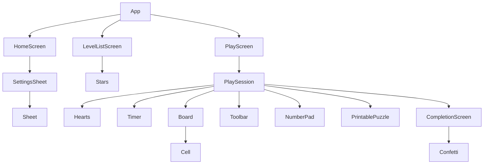

# UI Design — Sudoku Web Game

Tài liệu mô tả **hệ thiết kế, bố cục, từng màn hình, từng component, quan hệ giữa chúng, hệ animation** theo code hiện tại
(nhánh `ui-redesign`, dựa trên bản thiết kế `Sudoku_UI_Redesign.pdf`). Dùng làm căn cứ khi sửa giao diện: tra
[§14 Công thức thay đổi](#14-công-thức-thay-đổi) và [§13 Bẫy kỹ thuật](#13-bẫy-kỹ-thuật-đã-gặp) trước khi sửa.

Tài liệu đi kèm: [FUNCTION_DESIGN.md](FUNCTION_DESIGN.md) (chức năng, dữ liệu), `.claude/skills/game-ui/SKILL.md` (quy tắc cho AI/dev).

---

## 1. Nguyên tắc thiết kế

1. **Bàn cờ là trung tâm.** Mọi thứ khác (tim, đồng hồ, công cụ) phục vụ nó; chỉ bàn cờ được đầu tư chi tiết thị giác (đường kẻ, highlight).
2. **Phong cách "3D chunky"**: bề mặt phẳng bo tròn lớn + một **cạnh dày màu đậm bên dưới** (`box-shadow: 0 4px 0`). Nhấn = lún xuống cạnh. Tím là màu hành động chính.
3. **Mobile-first** (thiết kế gốc 390×844). Desktop chỉ là cột hẹp căn giữa (`max-w-md` = 448 px).
4. **Animation phục vụ phản hồi**, ngắn, không lặp quanh bàn cờ khi người chơi đang suy nghĩ; vòng lặp chỉ dành cho CTA.
5. **Không dùng màu làm kênh thông tin duy nhất**: ô sai = đỏ + viền; ô chọn = nền + viền; ô cùng số = nền + chữ đậm hơn; trạng thái tim/sao có `aria-label`.
6. **Hai theme (sáng/tối) từ cùng một bộ token**, component không biết mình đang ở theme nào.
7. **Tôn trọng `prefers-reduced-motion`**: tắt toàn bộ animation/transition, ẩn confetti.

---

## 2. Design tokens

Nguồn duy nhất: `src/index.css` (biến CSS) + `tailwind.config.js` (ánh xạ sang class). Giá trị là **bộ ba RGB cách nhau bằng dấu cách**
(để Tailwind ghép `/ <alpha>`), nên **không** viết hex vào biến.

### 2.1 Màu giao diện (đổi theo theme)

| Token (CSS) | Class Tailwind | Sáng | Tối | Dùng cho |
|---|---|---|---|---|
| `--c-page` | `bg-page` | `#EEF0FF` | `#0E1030` | nền trang, nền nút `btn-soft` |
| `--c-card` | `bg-card` | `#FFFFFF` | `#1B1E48` | thẻ, sheet, nút trắng |
| `--c-line` | `bg-line` / cạnh dưới `.card` | `#C7D2FE` | `#2E3376` | cạnh 3D của thẻ/nút trắng, hairline |
| `--c-soft` | `bg-soft` | `#E0E7FF` | `#262A63` | đường ray thanh tiến độ, công tắc tắt |
| `--c-ink` | `text-ink` | `#1E1B4B` | `#EEF0FF` | chữ chính |
| `--c-accent` | `text-accent` | `#4338CA` | `#A5B4FC` | chữ phụ, nhãn, số trên ô thường |

### 2.2 Màu bàn cờ (đổi theo theme)

| Token | Class | Sáng | Tối | Vai trò |
|---|---|---|---|---|
| `--b-cell` | `bg-board-cell` | `#FFFFFF` | `#1B1E48` | ô thường |
| `--b-line` | `border-board-line` | `#E0E7FF` | `#2E3376` | đường kẻ mảnh giữa ô |
| `--b-frame` | `border-board-frame` | `#312E81` | `#A5B4FC` | khung ngoài + đường kẻ ranh giới box 3×3 |
| `--b-peer` | `bg-board-peer` | `#F3F0FF` | `#242860` | hàng/cột/box của ô đang chọn |
| `--b-same` | `bg-board-same` | `#DDD6FE` | `#4C3A9A` | ô cùng số với ô đang chọn |
| `--b-sel` | `bg-board-sel` | `#C4B5FD` | `#6D4FD6` | ô đang chọn (đậm nhất) |
| `--b-hint` | `bg-board-hint` | `#FDE68A` | `#92400E` | ô được gợi ý |
| `--b-wrong` | `bg-board-wrong` | `#FEE2E2` | `#5B1A2A` | nền ô sai |
| `--b-wrong-ink` | `text-board-wrong-ink` | `#B91C1C` | `#FCA5A5` | chữ + viền ô sai |
| `--b-user` | `text-board-user` | `#6D28D9` | `#C4B5FD` | số người chơi nhập (given dùng `text-ink`) |

### 2.3 Màu cố định (giống nhau ở cả hai theme)

| Nhóm | Giá trị |
|---|---|
| Tím chính | `primary` `#7C3AED`, `primary-dark` `#5B21B6` (cạnh 3D & tiêu đề), `primary-light` `#A78BFA` |
| Nền màn tổng kết | `night` `#312E81` |
| Cam (thử thách) | nút `#C2410C` / cạnh `#7C2D12`; huy hiệu ngày `orange-500`; thẻ `orange-50` ↔ `#3A2417` (tối) |
| Công cụ | `btn-sky` (ghi chú bật) nền `#E0F2FE` cạnh `#7DD3FC` chữ `#0369A1`; `btn-amber` (gợi ý) nền `#FEF3C7` cạnh `#FCD34D` chữ `#B45309` |
| Tim | `rose-500` (đầy) / `accent/35` (rỗng) |
| Sao | `amber-400` viền `amber-500` |

**Màu cấp độ** (`LEVEL_THEME` trong `ui/levelLabels.ts` + `lvN` trong tailwind):

| Cấp | n | Nền `lvN` | Cạnh `lvN-edge` | Số mờ `lvN-ghost` | RGB nền / cạnh (cho `--btn-*`) |
|---|---|---|---|---|---|
| beginner | 1 | `#15803D` | `#14532D` | `#22A559` | `21 128 61` / `20 83 45` |
| easy | 2 | `#0369A1` | `#0C4A6E` | `#0A85C6` | `3 105 161` / `12 74 110` |
| medium | 3 | `#6D28D9` | `#4C1D95` | `#8B5CF6` | `109 40 217` / `76 29 149` |
| hard | 4 | `#C2410C` | `#7C2D12` | `#EA6A2A` | `194 65 12` / `124 45 18` |
| expert | 5 | `#BE123C` | `#881337` | `#E23A5E` | `190 18 60` / `136 19 55` |

### 2.4 Kiểu chữ

- **Nunito Variable** (`@fontsource-variable/nunito/wght.css`, đóng gói vào bundle ⇒ chạy offline trong APK; trình duyệt chỉ tải subset cần dùng, có `vietnamese`).
  Fallback: `system-ui, -apple-system, "Segoe UI", Roboto, sans-serif`.
- Độ đậm: nhãn 700–800, tiêu đề/số 800–900 (`font-extrabold`/`font-black`).
- Cỡ tiêu biểu: tên app 1.9rem; tiêu đề màn 1.5–1.875rem; tiêu đề mục `text-2xl`; thân `text-base`; nhãn phụ `text-sm`; huy hiệu `text-xs`.
- Chữ số dùng `tabular-nums` (đồng hồ, bộ đếm, ô cờ).

### 2.5 Hình khối

| Thành phần | Bo góc | Cạnh 3D |
|---|---|---|
| `.card` | 1.5rem | `0 4px 0 var(--c-line)` |
| `.btn` mặc định | 1rem | `0 4px 0 var(--btn-edge)` |
| Thẻ lớn (Chơi tiếp, hàng cấp độ) | 1.75rem / 1.5rem (`!rounded-3xl`) | như `.btn` |
| Ô màn (level tile), phím số | `!rounded-2xl` / `!rounded-xl` | như `.btn` |
| Header danh sách màn | chỉ góc dưới `2.25rem` | không |
| Bottom sheet | góc trên `2rem` | không |
| Khung bàn cờ | `rounded-2xl` + viền 3 px `board-frame` | không (nằm trong `.card`) |

Lề ngang trang `px-5` (20 px); khoảng cách dọc giữa khối `gap-4` (16 px; `2.5` ở màn thấp, xem §4).

---

## 3. Nguyên liệu dùng chung (class)

Định nghĩa trong `src/index.css`, `@layer components` (⇒ **utility Tailwind luôn thắng**).

### 3.1 `.btn` — bề mặt có thể nhấn

Thuộc tính điều khiển bằng biến: `--btn-bg`, `--btn-edge`, `--btn-fg` (bộ ba RGB), `--ring` (màu vòng CTA).

| Trạng thái | Hành vi |
|---|---|
| mặc định | nền `--btn-bg`, chữ `--btn-fg`, cạnh `0 4px 0 --btn-edge`, `min-height: 3.25rem`, `padding: 0 1.25rem`, chữ 800 |
| `:hover` (chỉ khi `hover: hover`) | `translateY(-2px)`, cạnh `0 6px 0`, `brightness(1.06)` |
| `:active` | `translateY(4px)`, cạnh `0 0 0` (lún hẳn xuống) |
| `:disabled` | `opacity .4`, `cursor: not-allowed`, không hover/active |

Biến thể:

| Class | Nền / cạnh / chữ | Dùng ở |
|---|---|---|
| `btn-primary` | `#7C3AED` / `#5B21B6` / trắng | CTA chính |
| `btn-orange` | `#C2410C` / `#7C2D12` / trắng | "Chơi" thử thách |
| `btn-white` | `card` / `line` / `ink` | nút icon header, thẻ cấp độ, phím số, công cụ |
| `btn-soft` | `page` / `line` / `ink` | nút phụ trong sheet/overlay/tổng kết |
| `btn-tile` | `card` / `line` / `accent` | ô màn chưa chơi |
| `btn-sky`, `btn-amber` | xem §2.3 | công cụ Ghi chú (bật) / Gợi ý |
| `btn-icon` | vuông `3.25rem`, `padding 0` | nút chỉ có icon |

Màu **động** (theo cấp, theo trạng thái) đặt bằng `style={{ '--btn-bg': …, '--btn-edge': …, '--btn-fg': … }}` — xem `COMPLETED_STYLE`,
`TAB_ACTIVE_STYLE`, nút Back của `LevelListScreen`.

### 3.2 Các class khác

| Class | Việc |
|---|---|
| `.card` | bề mặt `card` + bo 1.5rem + cạnh 3D `line` |
| `.cta-ring` | vòng sáng lan ra (`::after`, keyframes `ring` 2.4 s, lặp), màu theo `--ring`; tắt khi `:active`. Cần `position: relative` (đã có trong `.btn`) |
| `.cta-shine` | vệt sáng chạy ngang bằng `background-image` gradient (`shine` 4.2 s, lặp); tắt khi `:active` |
| `.board` | `container-type: inline-size` để chữ số ô co theo bề rộng bàn |
| `.cell-digit`, `.cell-note` | cỡ chữ ô: mặc định `clamp(...)` theo `vw`; nếu hỗ trợ `cqw`: `6.6cqw` (số) / `3.6cqw` (ghi chú) |
| `.sheet-handle` | thanh kéo nhỏ trên đầu bottom sheet |

---

## 4. Bố cục & responsive

### 4.1 Khung trang

```
html/body  (nền = --c-page, padding = safe-area, min-height 100dvh, display:flex column)
└─ #root   (flex:1, display:flex column)
   └─ <div key=screenKey class="mx-auto w-full max-w-md flex-1 flex-col animate-screen-in">   ← App
      └─ <main class="flex flex-1 flex-col …">                                              ← mỗi màn
```

- Chuỗi `flex` này làm `mt-auto` đẩy toolbar/nút CTA xuống đáy khi nội dung ngắn hơn màn hình. **Đừng** thêm `min-height: 100%` cho `html/body/#root` (từng làm hỏng — xem §13).
- Safe-area (khoét tai thỏ/thanh hệ thống) xử lý một lần ở `body` bằng `--safe-area-inset-*` (Capacitor `SystemBars: css`) hoặc `env(safe-area-inset-*)`. Overlay `fixed` (Sheet, Completion) tự cộng `env(safe-area-inset-bottom)` vào padding đáy.
- Cột `max-w-md` (448 px) cho **mọi** màn. Trang Home/Level/Play trên desktop trông như điện thoại căn giữa — chủ ý.

### 4.2 Cỡ bàn cờ

`width: min(100%, max(280px, calc(100dvh - 400px)))` (trong `Board.tsx`).
Nghĩa: tối đa bằng bề rộng cột; khi màn thấp thì co lại theo chiều cao nhưng không dưới 280 px. Con số `400px` ≈ tổng chiều cao phần còn lại
(header + tim/đồng hồ + toolbar + phím số + lề). **Đổi chiều cao các khối đó thì phải chỉnh lại số này.**

### 4.3 Màn thấp (≤ 700 px cao)

`PlaySession` dùng biến thể `[@media(max-height:700px)]:` để giảm `gap` (16→10 px), `pt/pb`, và `gap` của khối toolbar+phím. Đã kiểm ở 360×640 (vừa khít, không cuộn).

### 4.4 Cỡ vùng chạm (thực tế)

| Phần tử | Kích thước |
|---|---|
| Công cụ (Hoàn tác/Xóa/Ghi chú/Gợi ý) | 60×60 |
| Nút Back / Tạm dừng ở header Play | 48×48 |
| Nút Cài đặt / chuỗi ngày ở Home | 44 (cao) |
| Phím số | cao 64, rộng ≈ 35 (ở 390 px) — **hẹp hơn 44 px theo thiết kế gốc** |
| Nút đóng Sheet | 40×40 |
| Ô màn | ≈ 79×70 |

---

## 5. Các màn hình

### 5.1 Home (`#/`) — `ui/HomeScreen.tsx`

```
┌──────────────────────────────────────┐
│ [logo] Sudoku              [🔥 n] [⚙] │  header
│        Rèn trí não mỗi ngày          │
│ ┌──────────────────────────────────┐ │
│ │ CHƠI TIẾP                    ( ▶ )│ │  ResumeCard (btn-primary)
│ │ Mới bắt đầu · Màn 4              │ │
│ │ [⏱ 00:04] [♥ 2]                  │ │
│ └──────────────────────────────────┘ │
│ ┌──────────────────────────────────┐ │
│ │[TH10]  Thử thách hôm nay   [Chơi]│ │  Daily card (cam)
│ │[ 21 ]  Hoàn thành để giữ chuỗi…  │ │
│ └──────────────────────────────────┘ │
│ [✓ n Đã giải] [★ n Sao] [⏱ Kỷ lục]  │  3 thẻ thống kê
│ Chọn độ khó                          │
│ ┌ [1] Mới bắt đầu          3/100 ──┐ │  5 hàng cấp độ + thanh tiến độ
│ └ ▬▬▬──────────────────────────────┘ │
│ …                                    │
└──────────────────────────────────────┘
```

| Phần tử | Nguồn dữ liệu | Biến thể / điều kiện |
|---|---|---|
| Chuỗi ngày | `currentStreak(daily, today)` | 0 ⇒ ngọn lửa xám tĩnh; >0 ⇒ lửa cam + `animate-flame` |
| Cài đặt | — | mở `SettingsSheet` |
| ResumeCard | `last` + `byId` + `manifest` | nhãn: "Chơi tiếp" / "Màn tiếp theo" / "Bắt đầu chơi"; chip thời gian + tim chỉ khi có `SavedGame`; ẩn khi chưa có `manifest` |
| Daily card | `dailyId`, `isDailyDone` | chưa xong: nút "Chơi" (`cta-ring`); xong: dấu tick xanh (`animate-pop-in`); ẩn khi chưa có `manifest` |
| Thống kê | `summarizeByLevel(listGames())`, `stats` | kỷ lục `--:--` khi chưa có |
| Hàng cấp | `manifest.levels`, `summary[level]` | thanh xanh lá, chiều rộng `max(pct%, .75rem)` khi >0, `animate-bar-grow` |

Entrance: header → resume → daily → 3 thẻ → 5 hàng cấp, trễ `i×60 ms` (`stagger(i)`).

### 5.2 Danh sách màn (`#/level/:level`) — `ui/LevelListScreen.tsx`

```
┌──────────────────────────────────────┐
│ (nền màu cấp, bo đáy 2.25rem)     [1]│  ← số cấp khổng lồ, mờ (ghost)
│ [‹]  Mới bắt đầu                     │
│ [3/100 màn] [★ 6/300]                │
│ ▬▬▬━━━━━━━━━━━━━━━━━━━━━━━━━━━━━━━━ │  thanh tiến độ (vàng)
└──────────────────────────────────────┘
 [1–20][21–40][41–60][61–80][81–100]      tab nhóm 20 màn
 [ 1 ★★★][ 2 ★★☆][ 3 ★☆☆][ 4 CHƠI]        lưới 4 cột
 [ 5 ][ 6 ][ 7 ][ 8 ] …
 ┌────────────────────────────────────┐
 │        ▶  Chơi màn 4               │  nút cố định đáy (cta-ring + cta-shine)
 └────────────────────────────────────┘
```

| Trạng thái ô | Hiển thị | Điều kiện |
|---|---|---|
| Đã xong | nền xanh `34 197 94`, số trắng, 1–3 sao (`Stars`) | `status === 'completed'` |
| Màn đề xuất | `btn-primary` + `cta-ring`, chữ "CHƠI" | `index === pickNextIndex(...)` và chưa xong |
| Đang chơi (không phải đề xuất) | `btn-tile` + chấm tím | `status === 'in-progress'` |
| Chưa chơi | `btn-tile` | còn lại |
| Đang tải | 20 khối `animate-pulse` | `bank === null` |

Mỗi ô có `aria-label` "Màn N, <trạng thái>". Chuyển tab ⇒ lưới `key={page}` mount lại ⇒ phát lại `pop-in` (stagger `min(i×22, 440) ms`).

### 5.3 Màn chơi (`#/play/:id`) — `ui/PlayScreen.tsx` → `ui/PlaySession.tsx`

```
┌──────────────────────────────────────┐
│ [‹]      (MỚI BẮT ĐẦU)         [⏸]   │  header (grid 3rem | 1fr | 3rem)
│              Màn 5                   │
│ ♥ ♥ ♡                    [⏱ 00:04]   │  Hearts + Timer
│ ┌ card ────────────────────────────┐ │
│ │ ╔══════════ Board 9×9 ═══════════╗│ │  (+ overlay Tạm dừng khi paused)
│ │ ╚════════════════════════════════╝│ │
│ └──────────────────────────────────┘ │
│ [💡 bong bóng gợi ý + "Áp dụng"]     │  chỉ khi có hintPreview
│            (khoảng trống co giãn)    │
│ [↶ Hoàn tác][⌫ Xóa][✎ Ghi chú][💡 Gợi ý]│  Toolbar (badge = số gợi ý đã dùng)
│ [1][2][3][4][5][6][7][8][9]          │  NumberPad (dưới mỗi số: còn lại)
└──────────────────────────────────────┘
```

Chồng lớp (từ dưới lên): nội dung → overlay Tạm dừng (`z-20`, trong `.card` của bàn cờ) → `Sheet`/`CompletionScreen` (`fixed`, `z-50`).

**Overlay Tạm dừng**: phủ kín `.card` bàn cờ (che số, tránh gian lận) với nút "Tiếp tục" (focus tự động), "Đặt lại ván" (có `confirm`), "In câu đố" (ẩn ở Android). Nút ⏸ ở header đổi thành ▶. `Space` bật/tắt.

**Khi tạm dừng** ô không chọn được, phím số/Xóa/Hoàn tác/Gợi ý không tác dụng, đồng hồ dừng. (Riêng nút Ghi chú vẫn bật/tắt được vì không bị chặn.)

### 5.4 Hoàn thành — `ui/CompletionScreen.tsx` (phủ toàn màn, `fixed z-50`)

```
 nền night (#312E81) + confetti
        ★   ★   ☆        (giữa to hơn, cao hơn; sao đạt = vàng, chưa đạt = tím nhạt)
          ( 🏆 )          (đĩa vàng, rơi xuống)
╭────────── sheet trắng (trượt lên) ──────────╮
│            Tuyệt vời!                       │
│   Mới bắt đầu · Màn 5 · 2/3 sao             │
│ [KỶ LỤC MỚI]                                │
│ [00:12 Thời gian][1 Lỗi][0 Gợi ý]           │
│ Không mắc lỗi nào để nhận đủ 3 sao ☆        │   (hoặc "Hoàn hảo!…" khi 3 sao / "Chuỗi thử thách n ngày")
│ [        Màn tiếp theo →        ]           │  cta-ring + cta-shine
│ [ Chơi lại ]      [ Danh sách màn ]         │
╰──────────────────────────────────────────────╯
```

Biến thể: hết màn của cấp (`hasNext = false`) ⇒ nút chính thành "Danh sách màn" và bỏ nút phụ trùng. Màn thử thách hôm nay ⇒ dòng thông điệp thành "Chuỗi thử thách n ngày" (cờ lửa). Mở lại màn đã xong ⇒ hiện thẳng màn này.
Thời điểm: hiện sau 750 ms kể từ lúc hoàn thành.

### 5.5 Bảng Cài đặt — `ui/SettingsSheet.tsx` (bottom sheet)

4 công tắc (`role="switch"`): Báo số sai, Tô số giống nhau, Tô hàng/cột/ô, Tự xóa ghi chú; nhóm radio Giao diện (Theo máy/Sáng/Tối);
nút "Xóa toàn bộ tiến độ" (có `confirm`, rồi `location.reload()`). Mở từ Home.

---

## 6. Danh mục component

| Component (file) | Vai trò | Props chính | Dùng bởi | State riêng |
|---|---|---|---|---|
| `App` | khung + route + sở hữu state toàn cục | — | `main.tsx` | `manifest`, `levelBank` |
| `HomeScreen` | màn Home | `manifest, stats, daily, today, dailyId, settings, onSettingsChange, onNavigate` | App | `settingsOpen` |
| `LevelListScreen` | danh sách màn | `level, bank, onNavigate, onBack` | App | `pageOverride` |
| `PlayScreen` | tải puzzle rồi giao cho session | `puzzleId, onNavigate, settings, stats, updateStats, dailyId, today, daily, updateDaily` | App | `loaded`, `error` |
| `PlaySession` | điều phối một ván: phím, gợi ý, sóng, hoàn thành | + `puzzle, levelCount, onBack` | PlayScreen | `selected, noteMode, paused, hintPreview, wave, showCompletion, recordAtCompletion` |
| `Board` | lưới 9×9, tính `highlights` | `givens, board, solution, notes, version, selected, onSelect, settings, hintCells, wave` | PlaySession | — (`useMemo`) |
| `Cell` (`memo`) | một ô | `idx, value, notes, isGiven, isWrong, highlight, waveDelay, onSelect` | Board | `mounted` ref |
| `Toolbar` | 4 công cụ | `noteMode, onToggleNoteMode, onUndo, canUndo, onErase, canErase, onHint, hintPending, hintsUsed` | PlaySession | — |
| `NumberPad` | 9 phím + bộ đếm | `noteMode, remaining[], onDigit` | PlaySession | — |
| `Hearts` | 3 tim từ `mistakes` | `mistakes` | PlaySession | `lostIdx` (animation) |
| `Timer` | chip đồng hồ + `formatTime` | `elapsedMs, paused` | PlaySession | — |
| `Stars` | hàng sao | `count, total, size, filledClass, emptyClass, animated` | LevelList (ô xong) | — |
| `CompletionScreen` | tổng kết | `level, puzzleNumber, stars, elapsedMs, mistakes, hintsUsed, isNewRecord, dailyStreak, hasNext, onNext, onReplay, onList` | PlaySession | — |
| `Confetti` | giấy kim tuyến CSS | `count` | CompletionScreen | — |
| `Sheet` | bottom sheet chung (Esc/nền để đóng) | `title, onClose, children` | SettingsSheet | — |
| `SettingsSheet` | bảng cài đặt | `settings, onChange, onClose` | HomeScreen | — |
| `PrintablePuzzle` | bản in (ẩn trên màn hình, chỉ hiện khi `print`) | `puzzleId, level, puzzleNumber, givens, solution?` | PlaySession | — |
| `levelLabels.ts` | `LEVEL_LABELS`, `LEVEL_THEME` | — | Home, LevelList, PlaySession, Completion | — |

Hooks UI (`ui/hooks`): `useHashRoute`, `useSettings`, `useStats`, `useDaily`, `useSavedProgress`, `useGameSession` — chi tiết ở FUNCTION_DESIGN §9.

### 6.1 Cây component & luồng prop



Luồng điều khiển (con → cha): `Cell.onSelect → PlaySession.handleSelect`; `NumberPad.onDigit → handleDigit`; `Toolbar.on* → PlaySession`;
`CompletionScreen.onNext/onReplay/onList → PlaySession → onNavigate/reset`; `SettingsSheet.onChange → App.updateSettings`.
Luồng dữ liệu (cha → con): `PlaySession` đọc `GameSession` (qua `useGameSession`) và truyền **giá trị đã tách** (số, mask, boolean) xuống `Cell` để `memo` có tác dụng.

---

## 7. Hệ thống bàn cờ

### 7.1 Trạng thái một ô

Trục độc lập (do `Board` tính): `highlight ∈ {hint, selected, same-value, peer, none}`, `isGiven`, `isWrong`, `value`, `notes`, `waveDelay`.

**Độ ưu tiên nền** (cao → thấp): `hint` → `selected` → (`isWrong` nếu không phải hint/selected) → `same-value` → `peer` → `none`.

| Trạng thái | Nền | Chữ | Phụ |
|---|---|---|---|
| given | theo highlight | `ink`, đậm | không đổi được |
| người chơi nhập | theo highlight | `board-user` (tím) | `digit-pop` khi vừa điền |
| đang chọn | `board-sel` | đậm hơn | viền trong 3 px `accent/60` |
| cùng số | `board-same` | đậm hơn | chỉ khi `settings.highlightSameDigit` |
| peers | `board-peer` | — | chỉ khi `settings.highlightPeers` |
| gợi ý | `board-hint` | — | viền trong cam nhấp nháy (`hint-glow`) |
| sai (`showMistakes`) | `board-wrong` | `board-wrong-ink` | viền trong 2 px đỏ, số `shake`; vẫn đỏ khi đang chọn |
| ghi chú | — | `accent`, nhỏ | lưới 3×3, chữ số mới `digit-pop` |

`isWrong = settings.showMistakes && value≠0 && !given && value ≠ solution[idx]`. Nhãn truy cập thêm ", sai".

### 7.2 Đường kẻ

Mỗi ô tự vẽ `border-right`/`border-bottom`: ranh giới box (cột/hàng 3, 6) = 3 px `board-frame`; còn lại 1 px `board-line`; hàng/cột cuối không viền (khung ngoài `Board` lo). Không dùng SVG chồng lên để ô nhận được sự kiện trực tiếp.

### 7.3 Phím số

`remaining[d] = 9 − số ô đang có chữ số d` (tính **cả số sai**, nên không lộ thông tin đúng/sai khi `showMistakes` tắt). `remaining ≤ 0` ⇒ nút `disabled` + `scale-90 opacity-30`. Ở chế độ ghi chú, chữ số phím chuyển sang xanh trời.

### 7.4 Bong bóng gợi ý

Hiện khi `hintPreview ≠ null`: nền `amber-100` + cạnh 3D `#FCD34D` (tối: `amber-900/40` + `#92400E`), icon bóng đèn, `Step.explain`, dòng "Bấm “Áp dụng”…". `key={explain}` để mỗi gợi ý mới phát lại `screen-in`. Nút Gợi ý đổi nhãn "Áp dụng" và bóng đèn `animate-wiggle`.

---

## 8. Hệ animation

Định nghĩa: keyframes + `animate-*` trong `tailwind.config.js`; `ring`, `shine` (và quy tắc nhấn/hover) trong `src/index.css`.

### 8.1 Danh mục

| Hiệu ứng | Thời lượng / lặp | Kích hoạt | Ở đâu |
|---|---|---|---|
| nhấn/hover 3D | 0.12 s | CSS `:active`/`:hover` | mọi `.btn` |
| `ring` (`.cta-ring`) | 2.4 s, lặp | luôn | CTA chính, nút Chơi cam, ô "CHƠI", nút Tiếp tục |
| `shine` (`.cta-shine`) | 4.2 s, lặp | luôn | "Chơi màn N", "Màn tiếp theo" |
| `screen-in` | 0.3 s | mount (key theo route) | khung App, thẻ Home, bong bóng gợi ý |
| `fade-in` | 0.2 s | mount | nền Sheet/Completion, overlay Tạm dừng |
| `sheet-up` | 0.34 s | mount | Sheet, sheet của Completion (trễ 0.15 s) |
| `pop-in` | 0.38 s | mount (stagger) | ô màn, dấu tick, badge công cụ, ô thống kê tổng kết, số cấp khổng lồ |
| `bar-grow` | 0.8 s | mount | thanh tiến độ |
| `tab-pop` | 0.22 s | tab được chọn | LevelList |
| `digit-pop` | 0.24 s | số/ghi chú mới điền (sau khi ô đã mount) | `Cell` |
| `shake` | 0.4 s | số **sai** vừa điền | `Cell` |
| `wave` | 0.55 s, trễ `bước × 45 ms` | hoàn thành hàng/cột/box | `Cell` (qua `Board.wave`) |
| `hint-glow` | 1.2 s, lặp | ô thuộc `hintPreview` | `Cell` |
| `wiggle` | 0.7 s | có gợi ý chờ áp dụng | icon bóng đèn |
| `heart-lost` | 0.6 s | `mistakes` tăng (≤3) | `Hearts` |
| `float` | 2.2 s, lặp | luôn | nút ▶ ở thẻ Chơi tiếp |
| `flame` | 1.4 s, lặp | chuỗi > 0 | icon lửa ở Home |
| `star-pop` | 0.6 s, trễ `0.45 + 0.22·i` s | mount | sao ở Completion |
| `trophy-drop` | 0.8 s | mount | cúp ở Completion |
| `badge-wobble` | 1.6 s, lặp | có kỷ lục mới | huy hiệu |
| `confetti-fall` | 3.2–5.6 s, lặp, ngẫu nhiên cố định | mount | `Confetti` |

Hằng số trong code: `COMPLETION_DELAY_MS = 750`, `WAVE_DURATION_MS = 1100` (`PlaySession`), `WAVE_STEP_MS = 45` (`Cell`), thời gian `lostIdx` 700 ms (`Hearts`).

### 8.2 Quy tắc

1. **Entrance dùng `animation-fill-mode: backwards`** (đã đặt trong `animation` của tailwind). Nếu `both/forwards`, keyframe cuối giữ `transform: none` và **đè hiệu ứng nhấn/hover của `.btn`**.
2. **Không animate thứ có sẵn lúc mount** (given, ván khôi phục). `Cell` dùng `mounted` ref; `Hearts` so với `prevMistakes`.
3. **Kích hoạt lại animation = đổi `key`** của phần tử (số trong ô: `key={value}`; bong bóng gợi ý: `key={explain}`; lưới màn: `key={page}`; khung App: `key={screenKey}`).
4. Animation gắn với state tạm (`wave`, `lostIdx`) phải **tự xoá** bằng timer để lần sau thêm class lại sẽ phát lại.
5. Vòng lặp chỉ cho CTA/trang trí ngoài bàn cờ; không thêm vòng lặp lên bàn cờ ngoại trừ `hint-glow` (có chủ đích, chỉ khi người chơi yêu cầu gợi ý).
6. `prefers-reduced-motion` đã tắt tất cả (duration 0.01 ms, 1 lần, bỏ delay) và ẩn `.confetti`; không thêm ngoại lệ.
7. Trang chơi re-render mỗi giây (tick). Không gắn animation vào thứ phụ thuộc `version` mà không có điều kiện, kẻo phát lại mỗi giây.

---

## 9. Tương tác

| Hành động | Chuột/cảm ứng | Bàn phím |
|---|---|---|
| Chọn ô | chạm/click ô | mũi tên (vòng quanh mép) |
| Điền số | phím số | `1`–`9` |
| Điền lại đúng số đang có | = xoá ô | — |
| Xoá | nút Xóa | `0` / `Backspace` / `Delete` |
| Ghi chú bật/tắt | nút Ghi chú | `N` |
| Hoàn tác | nút | `U` |
| Gợi ý / áp dụng | nút | `H` |
| Tạm dừng/tiếp tục | nút ⏸ | `Space` |
| Đóng Sheet | chạm nền, nút × | `Esc` |

Khi hiện màn Hoàn thành, phím bị chặn (trừ thao tác bằng nút); khi tạm dừng chỉ `Space` còn tác dụng. Phím bị bỏ qua nếu focus đang ở `input/textarea`.
Không dùng `<input>` cho bàn cờ ⇒ bàn phím hệ thống không bật lên trên điện thoại.

---

## 10. Truy cập (a11y)

- Bàn cờ `role="grid"` (`aria-label="Bàn cờ Sudoku"`), mỗi ô `role="gridcell"` + `aria-label` ("Hàng 3, cột 5, số 7, cho sẵn" / "…, sai" / "…, trống") + `aria-selected`.
- Tim, sao: `role="img"` + `aria-label`; công cụ có `aria-label` kèm phím tắt; Ghi chú có `aria-pressed`; công tắc cài đặt `role="switch"` + `aria-checked`; chọn theme `role="radiogroup"`/`radio`; tab nhóm màn `role="tablist"`/`tab`.
- `Sheet`, overlay Tạm dừng, `CompletionScreen`: `role="dialog"` + `aria-modal`; nút chính được focus tự động. **Chưa có focus trap** (Tab vẫn có thể ra phía sau lớp phủ).
- Vòng focus: `outline 3px accent` toàn cục; ô cờ dùng `ring-4 ring-inset ring-accent`.
- Thông tin không chỉ bằng màu (xem §1.5).
- Cỡ chữ ô co theo bàn; chưa hỗ trợ tăng cỡ chữ riêng.
- **Chưa đo** tỉ lệ tương phản bằng công cụ cho bộ màu mới (tài liệu gốc yêu cầu ≥ 4.5:1) — cần kiểm khi chỉnh palette.

---

## 11. Theme sáng/tối

- Mặc định `settings.theme = 'system'`: CSS theo `prefers-color-scheme`. `'light'`/`'dark'` đặt `data-theme` trên `<html>` (`App` làm việc này trong `useEffect`).
- Bộ chọn trong CSS: `@media (prefers-color-scheme: dark) { :root:not([data-theme='light']) { … } }` và `:root[data-theme='dark'] { … }`; hai khối phải **giữ đồng nhất**.
- Tailwind `dark:` được cấu hình (`darkMode: ['variant', …]`) theo đúng hai điều kiện trên, dùng cho các màu pastel cố định (thẻ cam, ô thống kê, ô tổng kết). Màu nền/chữ chính **không** dùng `dark:` mà đi qua token.
- Các màu cố định (tím, màu cấp, cam, vàng) giữ nguyên ở cả hai theme.

---

## 12. Quyết định thiết kế & lệch so với bản PDF

| Nội dung | Quyết định | Lý do |
|---|---|---|
| Nút Đặt lại / In | chuyển vào overlay Tạm dừng | PDF chỉ có 4 công cụ; không muốn mất chức năng đã có |
| Tim | hiển thị `3 − lỗi`, không kết thúc ván | nguyên tắc "không phạt người chơi" |
| Sao | `max(1, 3 − lỗi)`, gợi ý không trừ | PDF: "1 lỗi ⇒ 2/3 sao"; gợi ý mang tính dạy học |
| Badge nút Gợi ý | số gợi ý **đã dùng** (ẩn khi 0) | PDF hiện "3" nhưng game không giới hạn gợi ý |
| Thử thách hôm nay + chuỗi | thêm tính năng (xem FUNCTION_DESIGN §8.3) | PDF có thẻ này |
| Thẻ Home khi không có ván dở | "Màn tiếp theo"/"Bắt đầu chơi" | tránh thẻ trống cho người mới |
| Màn đã hoàn thành khi mở lại | hiện thẳng tổng kết | tránh vừa mở đã trống bàn / tính lại thống kê |
| Theme tối | thêm | PDF chỉ có sáng; app trước đó đã hỗ trợ tối |
| Bảng Cài đặt | thêm | PDF có icon bánh răng nhưng không có màn |
| Back ở Play | về danh sách màn của cấp (replace) | phân cấp Home › Cấp › Màn |
| Phím số ≈ 35 px rộng | giữ theo PDF | 9 phím trên một hàng; bù bằng chiều cao 64 px |

---

## 13. Bẫy kỹ thuật đã gặp

1. **`min-height: 100%`** đặt sau `body { min-height: 100dvh }` làm body chỉ cao bằng nội dung ⇒ `mt-auto` không hoạt động. Chỉ để `100dvh` ở `body`.
2. **Keyframes chỉ được Tailwind phát ra khi có class `animate-*` dùng nó.** Keyframes dùng bằng CSS thuần (`ring`, `shine`) phải đặt trong `index.css`; keyframes dùng bằng inline style/animation tuỳ biến (confetti) vẫn cần một entry trong `animation` + dùng class `animate-…`.
3. **`fill-mode: both`** làm hỏng nhấn/hover (xem §8.2.1).
4. **`@layer components` < utilities.** Muốn utility ghi đè `.btn` thì bình thường; nhưng trạng thái `.btn:hover…`/`:active` có độ ưu tiên cao hơn utility thường ⇒ muốn ghi đè trong các trạng thái đó phải dùng `!` (ví dụ `!shadow-none`, `!rounded-2xl`, `!h-12`).
5. **Token là bộ ba RGB**, không phải hex; `rgb(var(--x) / .5)` mới đúng. Gán `--btn-bg: var(--c-card)` hợp lệ vì giá trị cuối vẫn là bộ ba.
6. **`animation` ghi đè thuộc tính cùng tên của class thường** (`transform`, `box-shadow`, `background-color`) trong lúc chạy. Keyframe `wave` đặt `background-color` có chủ đích; keyframe `badge-wobble` đặt `transform` ⇒ **không** đặt `translate` bằng class trên cùng phần tử (đã lỗi lệch huy hiệu; dùng thêm một lớp bọc để căn giữa).
7. **`Cell` render lại cả 81 ô** nếu `onSelect` không ổn định hoặc truyền object/mảng mới làm prop. Chỉ truyền giá trị nguyên thuỷ.
8. **`container-type: inline-size` trên `.board`** yêu cầu bề rộng bàn không phụ thuộc nội dung (đang là `width` tường minh).
9. **`useSavedProgress` phải đọc lại trong effect** vì màn Play lưu lần cuối khi unmount (sau render đầu của Home).
10. **`autoFocus` + phím Space**: overlay Tạm dừng focus nút "Tiếp tục" trong khi `Space` cũng được xử lý ở `window` (`preventDefault`). Khi thử thủ công chưa thấy bị kích hoạt hai lần, nhưng **chưa có test**; nếu sửa overlay hoặc thêm phần tử focus được, hãy kiểm lại luồng Space.
11. **Thiết bị Android cũ**: `cqw` và `100dvh` cần WebView mới; đã có fallback `clamp(vw)` cho chữ ô, nhưng `100dvh` chưa có fallback.

---

## 14. Công thức thay đổi

**Đổi màu giao diện/bàn cờ**: sửa biến ở **cả ba nơi** trong `index.css` (`:root`, khối `@media dark`, `:root[data-theme='dark']`). Không sửa trong component.

**Thêm màu/token mới**: biến `--x` (bộ ba RGB) ở ba nơi → `colors` trong `tailwind.config.js` bằng `token('x')` → dùng `bg-x`/`text-x`.

**Thêm biến thể nút**: thêm `.btn-foo { --btn-bg; --btn-edge; --btn-fg }` trong `@layer components`; không viết lại hover/active.

**Thêm cấp độ**: `LEVEL_LABELS` + `LEVEL_THEME` (levelLabels.ts) + màu `lvN` trong tailwind (nền, cạnh, ghost) + các danh sách cấp ở tầng chức năng (FUNCTION_DESIGN §14). Class màu phải xuất hiện **nguyên văn** trong `LEVEL_THEME` để Tailwind quét được.

**Thêm animation**: keyframes + `animation` trong tailwind (đặt `backwards` nếu là entrance) → bảng §8.1 → quyết định cách kích hoạt (mount / đổi `key` / state tạm có timer) → kiểm `prefers-reduced-motion`.

**Thêm màn mới**: route (FUNCTION_DESIGN §9.1) → `<main className="flex flex-1 flex-col …">` + `px-5` → dùng `.btn`/`.card` → entrance `animate-screen-in` (khung App đã có) → cập nhật tài liệu này (§5).

**Đổi chiều cao các khối trong màn Play**: cập nhật hằng `400px` ở `Board` và ngưỡng `700px` ở `PlaySession`, rồi thử ở 360×640, 390×844, 1280×800.

**Kiểm thị giác sau khi sửa** (cách đã dùng): `npm run build` → `npx vite preview` → chụp bằng Playwright + Edge ở 390×844 (sáng và tối) và 360×640; xem các trạng thái: Home có/không tiến độ, danh sách màn, ô sai, ghi chú, gợi ý, tạm dừng, sóng hoàn thành, tổng kết, Cài đặt.

---

## 15. Giới hạn hiện tại

- Chưa có test tự động cho component React; kiểm bằng chụp màn hình thủ công (§14).
- Chưa có focus trap trong các lớp phủ; chưa đo tương phản; chưa có âm thanh/rung.
- Phím số hẹp (≈ 35 px) dưới ngưỡng 44 px khuyến nghị — đã chấp nhận theo thiết kế.
- Chỉ có tiếng Việt (chuỗi viết thẳng trong component, chưa tách i18n).
- Một số chuỗi trạng thái lặp ở nhiều nơi (nhãn cấp, "x/3 sao") — sửa một nơi nhớ tìm các nơi còn lại bằng `Grep`.
